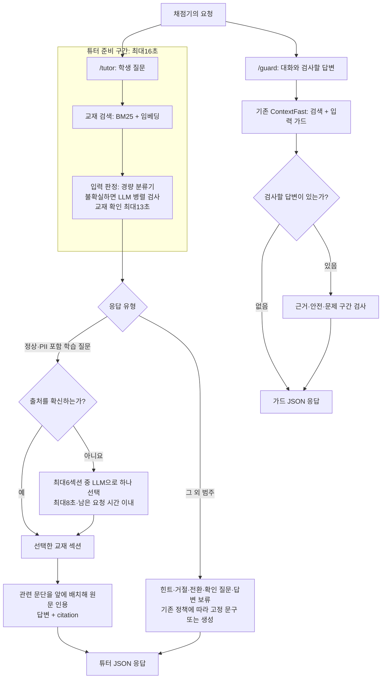

# 최종 제출 후보 보관 — 최신 갱신 2026-11-20

> **R7 종료 (2026-11-20):** 잔여40%에서 새 실험 중단, 수집·채점 완료. 기존 A/C 보존. 새 제출 시험 우선은 `jh_r7_binary_guard`: 같은 가드196개 대조3회에서 +.93/+1.87/+2.56, 마지막 혼합388은 A94.73→95.42(가드93.76→96.32). 튜터 결합8초95.28,12초94.78은 별도 탐색 후보다. 공개 개발 결과이며 새 실제 제출 성적은 없다. 965테스트·보호 파일 변경0, 로컬 커밋까지 완료. [최종 추천·구조·재현·한계](ROUND7_FINAL.md), [전체 과정](ROUND7_IMPROVEMENTS.md). 아래 최신 표기는 이전 시점의 이력이다.

> **A/C 각5회 비교 완료(2026-11-20 기록):** 마지막 무라벨 결과를 직전 안내 순서로 C5에 대응했다(A5/C5 순서 추정). A 평균 총점84.640/가드88.446/70.289초, C83.774/87.712/69.586초다. 평균·중앙값을 함께 보고 운영 추천은 A `jh_cm_char_mlp50` 유지, C 보조 보존이다. 표본5회·다른 seed로 통계적/인과적 우위는 미확정이며 튜터 평균 차이도0.998점이다. 총점 최고 A3 85.50, 가드 최고 C3 90.45는 관측 기록이며 마지막 보고는 C5 83.52다. 10회 모두 공식 오류0, 내부 오류 미확인. [최종 비교·전체 기록](AC_REPEAT_SUBMISSION.md). 아래 “최신” 표기는 이전 시점 이력이다.

> **추론 수준 분리 실험 완료(2026-11-19):** 완결15회·2,924응답에서 medium의 반복 개선이 없어 기존 A/C를 유지한다. 근거 medium2000은 짝비교2회 평균93.745, C94.395이며 p95 평균은18.948초 대12.345초였다. 튜터 입력/교재 선택/생성 medium도 첫 비교에서 A보다 낮았다. 제공 API 비스트리밍 상한2000을 확인했고 스트리밍·평가기·기존 A/C·환경변수는 바꾸지 않았다. 로컬 API 작업 종료, 실제 A/C 반복 제출 가능. [전체 점수·시간·실패·재현](REASONING_ABLATION.md).

> **최신 실제 제출 D:** `jh_np_peace_block` 총점84.09 / 튜터78.67 / 가드89.52 / 62.816초, 600요청·공식 오류0. C보다 가드−0.36·9.508초 빠르지만 다른 seed 단회라 원인 분리 불가. 강화된 입력 프롬프트의 추가 이득 미확인. 최종 보존 A85.41, 다음 검증 A/C 반복 유지. 같은 계정 마지막 제출은D84.09. [seed·결과·분석](NEURAL_PEACE_SUBMISSIONS.md). 아래 F/C 최신 문구는 이전 시점 기록이다.

> **후속 실제 제출 F/C:** F85.00 / 튜터82.08 / 가드87.92 / 63.950초, C84.65 / 튜터79.42 / 가드89.88 / 72.324초. 모두600요청·공식 오류0. 기존 총점 최고 A85.41을 보존하고, 다음 검증은 가드가 유망한 C와 A 반복 비교를 우선한다. 단회·다른 seed이므로 C의 가드+0.31을 확정 개선으로 보지 않는다. 같은 계정의 마지막 제출은 C84.65. [실제 결과·해석](NEURAL_PEACE_SUBMISSIONS.md). 아래 F 우선 추천은 제출 전 로컬 비교 시점의 이력이다.

> **가드 융합 재검증(2026-11-19):**36회 비교에서 안정적 가드 상승이 없어 아래 실제85.41 후보를 유지한다. 추가 제출 시험은 F `jh_np_input_budgets`(timeout 완화), 독립 출력 검증은 C `jh_np_timeouts`. 둘 다 새 비공개 점수는 없으며 최종 후보 교체 권고가 아니다. [근거·전체 결과](NEURAL_PEACE_GUARD.md).

> **튜터 확장 검증(2026-11-19):** 새 튜터 MLP 후보의 혼합2회 평균은 기존보다 전체0.10점 낮았고, 실제 jh_tm_replace 제출도84.17(튜터79.83/가드88.51)로 기존85.41보다 낮았다. 아래 최종 추천을 유지한다. 가드 MLP만 적용된 기존 후보와 튜터까지 확장한 실험 후보를 구분한다. [비교 결과](TUTOR_MLP_RESULTS.md).

## 최신 잠정 우선 후보 — 문자 MLP50

사용자 명시 A3(`jh_cm_char_mlp50`)85.50(튜터81.17/가드89.83),70.621초·600요청·공식 오류0으로 공유된 실제 제출 총점 최고를 갱신했다. 실제 시작 로그·커밋은 별도 확인하지 않았다. 이전 단회85.41은 과거 기록으로 보존한다. 이번 반복 A/C 각5회 평균은84.640/83.774이며 A를 운영상 유지한다(A5/C5는 순서로 잠정 대응). 가드 평균88.446/87.712, 중앙값88.61/87.61도 A가 높지만 표본5회와 서로 다른 seed로 통계적 우위를 확정하지 않는다.

예정된 각5회 비교는 완료했다. A를 우선 보존하고 C는 보조 후보로 유지한다. 최종 집계는 계정별 마지막 제출이므로 재제출이 최고점을 자동 보존하지 않는다. 기존 material_budget과 focused는 백업으로 그대로 남긴다. 이 변경은 후보 추천 기록이며 서버 기본값이나 모델 코드를 바꾸지 않는다.

브랜치 `experiment/kimjaehak-peace-guard-fusion`, 실행 코드가 포함된 원격 체크포인트 `492af6129434f5bd49e7ed684f6d4edb19e94f23`. 설정은 `--variant jh_cm_char_mlp50 --embedding-mode env --request-slots 64 --host 0.0.0.0 --port 8000`이다. 환경변수 우선순위와 실행 명령은 [제출 안내](CLASSIFIER_MATRIX_SUBMISSION.md), 점수 비교 근거는 [실험 기록](CLASSIFIER_MATRIX.md)을 따른다.

## 추가 보존 후보 — 임베딩 MLP50

사용자가 variant를 명시한 `jh_cm_dense_mlp50` 실제 제출84.81 / 튜터81.00 / 가드88.63 / 60.985초, 공식 오류0. 문자 MLP50보다 전체0.60점 낮고8.483초 빠르다. 점수 우선 추천과 튜터 확장 기준선은 문자 MLP50을 유지하되 임베딩 MLP50은 차선 비교 후보로 보존한다. 두 후보 모두 서로 다른 seed의 단회이므로 안정적 우열은 미확정이다.

임베딩 MLP50의84.81 이후 튜터 확장84.17, F85.00, C84.65, D84.09와 이번 A/C 각5회가 보고됐다. 현재 최고 관측 총점은 A3 85.50, 마지막 보고는 순서상 C5 83.52다. 같은 계정이라면 마지막 제출 점수는83.52이며 재제출로85.50을 그대로 복원할 수 있다고 보장하지 않는다. 실행은 위 브랜치·코드에서 variant만 `jh_cm_dense_mlp50`으로 바꾸고 나머지 설정은 같다.

## 이전 후보 선택 이력 (2026-11-17~18)

이하 material_budget 우선·focused 백업 판단은 당시 기록이며, 최신 추천은 위 문단을 우선한다.


> **R6 보존 확인 (2026-11-18):**68회 비교 후에도 이 문서의 최종 두 후보를 유지한다. 새 비공개 결과는 없다. normal94_sparse는 추가 제출 시험 후보이며 product_context는 미실험이다. [최종 분석](ROUND6_FINAL.md).

> **R5 보존 확인:** [짧은·긴 청크 후보 비교](DUAL_GRANULARITY.md)를 별도 수행했다. 이 문서의 기존 최종 후보 코드와 추천은 유지한다. 신규 후보는 비공개 제출 검증 전의 실험 후보다.

## 선택 기록

현재 최종 제출 우선 후보는 **1번 `jh_r4_material_budget`**, 백업은 **`jh_r3_selected_focused`**다. 이후 제출 준비 시 이 문서와 [실제 제출 기록](PRIVATE_SUBMISSIONS_R4_20261117.md)을 우선한다. 코드 기본값을 바꾸거나 새 파이프라인 별칭을 만들지는 않았다.

| 역할 | 정확한 variant | 제출 관측 | 전체 평균 | 튜터 평균 | 가드 평균 | 시간 평균 |
|---|---|---|---:|---:|---:|---:|
| 최종 제출 우선 | `jh_r4_material_budget` | 84.54, 84.47 | 84.505 | 80.330 | 88.685 | 66.251초 |
| 백업·비교 기준 | `jh_r3_selected_focused` | 83.99, 84.68, 83.88 | 84.183 | 80.110 | 88.260 | 70.724초 |

제출 보고는 모두 600요청이며 공식 시간 초과·형식 오류·판정 오류는 0이었다. 표본 수가 적고 seed가 다르므로 통계적 우위나 코드 변경의 인과 효과가 확정된 것은 아니다. 현재 선택은 누적 관측에 따른 운영 판단이다. 과거 최고 단회 84.68과 현재 마지막 보고 84.47은 구분한다.

두 후보의 코드를 모두 포함한 원격 체크포인트는 **`c88ff61ad264c8dff30bef3e548d0ca4e5ccf011`**, 브랜치는 `experiment/kimjaehak`이다. 이 체크포인트 이후 이 문서 작성까지는 제출 기록 문서만 변경했다. 실제 런박스 commit·환경은 독립 확인하지 않았으며 사용자가 명시한 후보 이름과 안내한 명령을 근거로 결과를 대응했다.

이름이 비슷한 `jh_r4_budget_stream`(2번), `jh_r4_source_id_only`(3번), `jh_r4_source_minimal`과 혼동하지 않는다. 최종 우선 후보는 **material_budget**이다.

## 실행 설정

기존 `.env`를 사용한다. 비교 조건은 embedding `env`, request slots **64**, 호스트 `0.0.0.0`, 포트 `8000`이다. 클래스의 기본 슬롯 수는32이므로 실행 인자의64를 생략하지 않는다. 제출은 런박스에서 수행하며, 실제 모델 연결은 `.env`에 따른다. API 키는 이 문서나 Git에 기록하지 않는다.

최종 우선 후보:

```bash
.venv/bin/python experiments/jh_server.py \
  --variant jh_r4_material_budget \
  --embedding-mode env \
  --request-slots 64 \
  --host 0.0.0.0 \
  --port 8000
```

백업 후보(기존 서버를 종료한 뒤 실행):

```bash
.venv/bin/python experiments/jh_server.py \
  --variant jh_r3_selected_focused \
  --embedding-mode env \
  --request-slots 64 \
  --host 0.0.0.0 \
  --port 8000
```

시작 로그의 variant와 `임베딩 있음`, `Application startup complete`를 확인한다. 서버 준비가 끝난 뒤 현재 런박스 주소·TEAM_TOKEN·코드 commit을 반영한 submission.json으로 제출한다. 계정별 마지막 제출이 집계되며, 서버만 바꿔서는 기존 제출 기록이 바뀌지 않는다.

## 두 후보의 구조 차이

material_budget은 focused를 직접 상속한다. 검색기·학습 분류기·프롬프트·출처 선택·교재 인용·guard 알고리즘은 같다. 차이는 **튜터 앞단의 시간 배분 두 값**이다.

| 항목 | focused | material_budget |
|---|---|---|
| 튜터 교재 확인 호출 제한 | 최대10초 | 최대13초 |
| 튜터 검색+입력 판정 구간 제한 | 최대14초 | 최대16초 |
| 요청 전체 제한 | 26초, 슬롯 대기 포함 | 동일 |
| 불확실한 출처 선택 | 최대6섹션, low/2000토큰/최대8초 | 동일 |
| 교재 확인 토큰 한도·추론량 | 1500토큰·low | 동일 |
| guard 교재 확인·prepare 제한 | 10초·14초 | 동일 |
| 추가 LLM 호출·재시도 | 이 변경으로 추가 없음 | 동일 |
| 출처 선택 호출 방식 | 비스트리밍, section+reason | 동일 |
| 채점기에 반환하는 응답 | 완성된 JSON 하나 | 동일 |

표의 시간은 실제 소요 시간이 아니라 상한이다. 교재 확인은 다른 입력 검사와 병렬로 실행되며 prepare 구간 안에 포함된다. 13+16+8초를 더하는 구조가 아니다. 1번도 전체26초 안에서 동작하며 남은 시간에 맞춰 호출을 제한한다. 앞 단계가 오래 걸리면 출처 선택·답변 처리의 여유가 줄 수 있다. 제한을 늘려도 실제 총시간이 반드시 늘거나 점수가 반드시 오르는 것은 아니다.

1번은 요청별 pipeline의 얕은 복사본에서 tutor prepare_limit만16으로 설정한다. 공유 pipeline 자체의 prepare_limit은 바꾸지 않아 동시에 처리되는 guard 요청에 적용되지 않는다.

## 전체 시스템: 세 종류의 모델과 교재 검색

여기서 현재 모델은 아래 요소를 조합한 파이프라인을 뜻한다. LLM 자체의 내부 신경망 구조를 변경하거나 미세조정한 것이 아니다.

| 구성 | 확인한 설정·구현 | 역할 |
|---|---|---|
| 제공 LLM | `openai/gpt-5-nano` | 불확실한 의도 판정, 교재 근거 확인, 출처 선택, 필요한 답변 생성과 출력 가드 |
| 제공 임베딩 | `text-embedding-3-small` | 표현이 달라도 의미가 가까운 교재 조각 검색 |
| 로컬 경량 모델 | 공개 자료로 학습한 문자 TF-IDF + 로지스틱 회귀 등 | 입력 범주·교재 섹션·유해 요청 유형 판단, 출력 문제 구간 보정 |
| 교재 검색 | BM25 + 임베딩 검색 | BM25 상위10조각을 먼저 놓고 임베딩 상위10 중 중복되지 않은 조각을 보완 |

모델 이름은 완료 실험 manifest에서 확인한 값이며 런타임은 `.env`로 정해진다. 로컬 분류기는 공개 데이터로 서버 준비 시 학습하며 비공개 제출 문항·정답을 사용하지 않는다. 교재 조각과 임베딩 색인도 서버 준비 시 로드한다. 임베딩을 사용할 수 없으면 기존 BM25 검색으로 복구한다. RRF로 순위를 합치는 후보는 현재 최종 후보가 아니다.

## 요청 흐름



두 엔드포인트는 독립 요청이다. `/tutor`의 응답을 자동으로 `/guard`에 보내는 직렬 구조가 아니다. 두 경로 모두26초의 요청 예산을 쓰며, 최종 후보의 시간 확대는 tutor에만 적용한다.

### 튜터 흐름을 읽는 방법

1. 대화 전체를 바탕으로 교재 조각을 찾는다. 임베딩은 BM25가 놓친 후보를 보완하며, 마지막 사용자 발화도 후속 출처 선택과 문단 재정렬에 사용한다.
2. 마지막 질문의 범주를 경량 분류기로 판정한다. 확신이 높은 경우 해당 경로를 사용하고, 불확실한 경우 차단 의도·기타 의도/개인정보·교재 내 근거를 LLM으로 병렬 확인한다. 앞의 짧은 판정들은 필요할 때만 세 번째 표를 추가한다. 교재 확인은 답할 근거가 있는지를 판단하는 단계다.
3. 정상/PII 학습 질문의 출처를 공개 학습 섹션 모델이 충분히 확신하면 유지한다. 현재 상속 경로의 .98 gate 및 tutor 전용 .90 gate가 적용된다. 불확실한 경우 기존 선택 섹션, 마지막 질문 BM251위, 검색 조각의 섹션을 모아 최대6개 중에서 LLM이 선택한다. 이것은 교재 확인과 별개인 출처 선택 단계다.
4. 선택한 섹션의 관련 문단을 앞에 놓고 원문을 답변으로 인용한다. 일반적인 정상 질문의 주 경로에서는 선택 이후 자유 생성 LLM을 다시 호출하지 않는다. 문단·표·코드를 보존한다. 섹션이 비었거나4000자 한도를 넘는 경우 기존 생성 경로로 복구한다.
5. 정답만 요구·유해 요청·자료 밖 질문 등은 기존 범주별 정책을 따른다. 모든 요청을 교재 인용으로 처리하지 않는다.

### guard 흐름을 읽는 방법

기존 ContextFast를 그대로 사용한다. 입력은 공개 학습 분류기와 필요 시 LLM 판정으로 검사한다. 검사할 후보 답변이 있으면, 허용 입력에서는 교재 근거 검사를 최대5회 병렬 수행해 구간 판정의 합의도를 비교하고 출력 구간 모델로 보정한다. 차단 입력은 기존 정책을 적용하며, 답변에 거절·전환 표현이 있으면 실제로 요청을 수행하지 않았는지 의미 검사를 한다. 조건별 분기가 있으므로 모든 요청이 항상5회 검사와 추가 검사를 모두 거치는 것은 아니다.

이 경로는 Peace의 의도 경계 기준을 반영한 후 여러 실험을 거친 ContextFast다. 초기에 복사한 Peace guard 클래스를 그대로 호출하는 파이프라인이라고 설명하지 않는다.

## 코드 근거와 보존 범위

- 시간 배분: [material_budget.py](../../pipelines/kimjaehak/material_budget.py)
- 문단 재정렬: [focused_excerpt.py](../../pipelines/kimjaehak/focused_excerpt.py)
- 출처 선택: [source_extract.py](../../pipelines/kimjaehak/source_extract.py)
- 교재 인용과 복구: [extractive_answer.py](../../pipelines/kimjaehak/extractive_answer.py)
- 기존 guard: [guard_fitted.py](../../pipelines/kimjaehak/guard_fitted.py)
- 검색: [core/search.py](../../core/search.py)

이번 작업은 후보와 구조의 기록이다. 실행 코드·모델 설정·평가기·submission.json을 변경하거나 추가 API 실험·제출을 실행하지 않았다. 자동 실험 중단 상태도 유지한다.


교재 분할·검색·후보 결합·출처 선택을 확대한 그림은 [RETRIEVAL_STRUCTURE.md](RETRIEVAL_STRUCTURE.md)에 보관했다.
