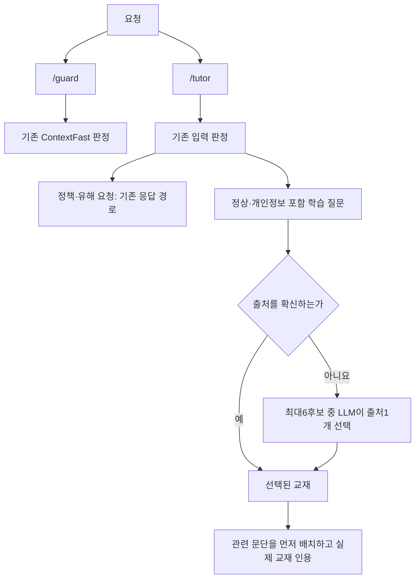

# 김재학 실험 인수인계

> **튜터 MLP 비교 완료 (2026-11-19):** 기준선/선별/교체 후보를4개 묶음·10회·2,671응답으로 비교, 미채점0·836테스트 통과. 혼합2회 평균 전체는기존95.18/교체95.08, 튜터95.115/94.985로안정적상승미확인. 실제85.41 후보 `jh_cm_char_mlp50` 유지. 새 `jh_tm_selective`, `jh_tm_replace`는실험용보존·비공개점수없음. [결과](TUTOR_MLP_RESULTS.md) / [실행 명령](TUTOR_MLP_SUBMISSION.md). 아래 계획/추천은각시점이력이다.

> **최신 실제 제출 (2026-11-19):** 사용자가 명시한 `jh_cm_dense_mlp50`, 전체84.81 / 튜터81.00 / 가드88.63 / 60.985초, 공식 오류0. 문자MLP보다 전체−0.60·8.483초 빠르다. 점수 우선과 튜터 확장 기준선은 char_mlp50 유지, dense_mlp50은 차선 후보로 보존. 최신보고84.81과 관측최고85.41을 구분한다. 같은 계정이면 마지막 제출이84.81이다. [비교 기록](CLASSIFIER_MATRIX.md#실제-제출-5--임베딩--작은-신경망-2026-11-19).

> **튜터 MLP 확장 계획 (2026-11-19):** 현재85.41 후보의 가드를 고정하고 튜터 입력만 A(기존)/B(선별 MLP)/C(범주 게이트 교체)로 비교하는 [계획](TUTOR_MLP_PLAN.md)을 작성했다. 구현·API 실험은 아직 미실행. 임베딩 MLP50 실제 제출84.81은 위 최신 기록에 반영했다.

> **최신 최고점·우선 보존 후보 (2026-11-19):** 직전 안내에 따라 `jh_cm_char_mlp50`로 대응, 전체85.41 / 튜터81.25 / 가드89.57 / 69.468초, 공식 오류0. 이전 보고 최고84.68보다 +0.73. 잠정 우선 후보를 char_mlp50으로 갱신하고 현재 제출 결과를 유지할 것을 권한다. 단회·다른 seed로 신경망 효과를 확정하지 않는다. material_budget/focused는 백업 유지. [전체 비교](CLASSIFIER_MATRIX.md#실제-제출-4--문자-tf-idf--작은-신경망-2026-11-19). 아래 추천은 각 시점의 이력이다.

> **최신 직접 대조 (2026-11-19):** 직전 안내에 따라 fast_cancel로 대응, 전체82.77 / 튜터78.42 / 가드87.11 / 53.955초, 공식 오류0. dense_lr50 대비 전체−0.93이나 가드+1.29. 튜터 코드는 같고 각1회·seed가 달라 전체 차이를 분류기 효과로 해석하지 않는다. 기존 최종 추천 유지. 다음 비교용은 char_mlp50이며 로컬 우월성은 입증되지 않았다. [기록·분석](CLASSIFIER_MATRIX.md#실제-제출-3--fast_cancel-직접-대조-2026-11-19).

> **수정 후 실제 재제출 (2026-11-19):** 시작 로그로 dense_lr50 확인, 전체83.70 / 튜터81.58 / 가드85.82 / 57.132초, 600요청·공식 오류0. 사용자 시작 로그로 ready=true / fallback_only=false / 검색 임베딩 있음 확인. 요청별 실행 오류 여부와 실제 커밋 해시는 미확인. 수정 전84.09는 분류기 우회 실행이므로 두 결과를 평균으로 합치지 않는다. 기존 최종 추천 유지, 다음 직접 비교는 같은 환경의 fast_cancel. [결과·판단](CLASSIFIER_MATRIX.md#실제-제출-2--환경별칭-수정-후-재제출-2026-11-19).

> **환경/별칭 수정 완료 (2026-11-19):** 로컬 .env 7개 설정 보존, 두 API 키 동기화. 현재 서버·비교 진입점은 프로세스 환경변수 우선. 두 small 모델 표기의 호환성만 인정하고 API 모델명은 그대로 전송. API 2회에서 별칭 벡터 cosine 1.0, 전체 829테스트 통과. 런박스 업데이트 후 `CLASSIFIER_EMBEDDING ready=true` 확인하고 dense_lr50 재제출 필요. [환경·실행 안내](CLASSIFIER_MATRIX_SUBMISSION.md).

> **제출 해석 정정 (2026-11-19):** 사용자 추가 로그에서 `matrix_embedding:UnavailableOrModelMismatch` 다수 확인. 해당 요청은 새 임베딩 분류기를 건너뛰었다. 84.09를 의도한 dense_lr50의 정상 성능으로 비교하지 않는다. 로컬 cm07에서는 같은 오류 0건. 다음은 런박스 설정 확인·수정 후 dense_lr50 재제출이 우선이며, 그 뒤 fast_cancel을 직접 비교한다. [추가 로그 분석](CLASSIFIER_MATRIX.md#추가-로그에-따른-해석-정정--2026-11-19). 아래 첫 제출 판단은 로그를 받기 전 이력이다.

> **분류기 후보 실제 제출 보고:** 직전 안내에 따라 `jh_cm_dense_lr50`로 추정, 전체84.09 / 튜터79.58 / 가드88.59 / 73.842초, 600요청·공식 오류0. 런박스 실제 variant·커밋은 독립 확인하지 않았다. 로컬 상승의 제출 재현은 아직 확인되지 않았고 기존 material_budget/focused를 유지한다. 다음 직접 대조는 `jh_pg_fast_cancel` 권장. [기록·분석](CLASSIFIER_MATRIX.md#실제-제출-1--임베딩-lr50-사용자-보고).

> **새 분류기 비교 완료 (2026-11-18):** 문자/제공 임베딩 × 로지스틱/작은 신경망 구현·비교, HTTP 4,124개 및 전체 824테스트 완료. 혼합388에서 임베딩 LR50 전체95.96/가드96.61, 기존 fast_cancel 전체95.70/가드95.70. 다른184문항에서는 기존이 우세해 확정 개선으로 취급하지 않는다. 실제 제출 시험은 `jh_cm_dense_lr50` 우선, `jh_cm_char_mlp50`은 신경망 비교용. 기존 최종 후보 보존. [설계·전체 결과](CLASSIFIER_MATRIX.md) / [런박스 제출 명령](CLASSIFIER_MATRIX_SUBMISSION.md).

> **Peace 융합 라운드 종료 (2026-11-18):** `experiment/kimjaehak-peace-guard-fusion`. 사용자가 잔여80%(사용20%) 중단을 명확히 했으나 이전 반대 해석으로 확인 사용량25%까지 진행했다. 새 실험 중단, 이미 실행 중인 비교만 완료. HTTP11,496개·미채점0·전체815테스트 통과. 기존 material_budget/focused 유지, 새 제출 시험 우선 fast_cancel(입력 의도16에서는 오차단 회귀도 관측). [최종 후보·재현·인수인계](PEACE_GUARD_FUSION_FINAL.md) / [전체 결과](PEACE_GUARD_FUSION.md). 이번 라운드 push·비공개 제출 없음.

> **R6 종료 (2026-11-18):** 잔여15%에서 새 실험을 중단하고68회·10,361요청 채점 완료(pending0),614개 테스트 통과. 기존 material_budget/focused 유지, 추가 제출 시험 후보 normal94_sparse. product_context는 미실험. [최종 판단·인수인계](ROUND6_FINAL.md) / [전체 기록](ROUND6_TEAM.md) / [중단 근거](ROUND6_STOP.json). R6 새 커밋은 아직 푸시하지 않았다. 아래 종료·재개 문구는 이전 이력이다.

> **R5 별도 비교 완료:** [짧은·긴 청크 실험](DUAL_GRANULARITY.md) — 세 후보 × 두 자료 × 두 번, HTTP1,836요청 채점 완료. 신규 `dual6`·`dual_all` 분리, 기존 최종 후보 보존. 신규 제출 시험은 dual_all 우선이나 실제 비공개 점수는 아직 없음. 아래 R4 종료·사용량 기록은 과거 이력이다.

> **최종 후보 보관:** [FINAL_CANDIDATES.md](FINAL_CANDIDATES.md) — 우선 material_budget, 백업 focused. 정확한 실행 명령·시간 배분 차이·전체 구조도를 함께 기록했다.


> **이전 실제 제출:** 새1번 재제출 `jh_r4_material_budget` 전체84.47 / tutor80.58 / guard88.37 / 64.816초, 공식 오류0.
> **현재 실제 제출 추천: `jh_r4_material_budget / env / slots64`.** 두 번 평균84.505로 focused 세 번 평균84.183보다 소폭 높다. 통계적 우월성이 확정된 것은 아니다.
> [R4 제출 기록과 비교](PRIVATE_SUBMISSIONS_R4_20261117.md)를 우선한다. 기존 최고84.68과 최신84.47은 구분하며, 아래 최신/추천 문구는 각 기록 당시의 판단이다.


> **최신 종료: R4, 잔여40% 기준.** 48회·8,118요청 채점 완료, 미채점0. 새 후보의 안정적인
> 개선을 확인하지 못해 **실제84.68 관측의 `jh_r3_selected_focused / env / slots64` 유지**.
> material budget 첫98.18은 반복되지 않았고, stream 조합·ID-only·실습 구분·minimal도 미채택.
> 출처 minimal은88.16→73.90으로 하락했다. 테스트453개 통과, 평가기·core·server·SPEC·public·KB 원본 유지.
> 사용량 확인 중 자동 대기열에서 마지막1회가 시작된 경계 상황도 기록했다. 이후 새 실험 없이 정리 완료.
> [전체 결과·분석·재현](ROUND4_TUTOR.md) / [집계](round4_results.json) / [중단 근거](ROUND4_STOP.json).
> 원격 push·새 비공개 제출 없음. 아래 재개/60% 종료 문단은 과거 시점의 기록이다.


> **실험 재개:** 사용자가 잔여40%까지 개선 반복을 요청했다. 시작 잔여57%에서 이전 중단 표식을
> 해제했고 새 기록은 [ROUND4_TUTOR.md](ROUND4_TUTOR.md)에 남긴다. 기준선 selected_focused,
> guard·주최측 평가기 유지. 아래60% 종료는 이전 라운드의 이력이다.

> **최신: 1번 focused 재제출84.68 / tutor81.58 / guard87.78 / 67.089초.**
> 사용자 보고 기준600요청·공식 오류0, seed `5687b61849dd37bfadc0f3d3a454a6f8`.
> focused 두 번 전체83.99/84.68, 평균84.335다. 현재1번과 최신 제출을 유지하는 것을 추천한다.
> 3번과 이번 소요 시간 차이는 .617초여서 앞선10.175초를 고유한 속도 차이로 보지 않는다.
> 실행별 표본이 다르고2·3번은 이번 비교 각1회이므로 통계적 우위는 아직 확정하지 않는다.

> **최초 세 후보 실제 제출 보고(2026-11-17):** 안내한1→2→3 순서로 해석하면
> focused **83.99 / tutor79.17 / guard88.81 / 76.647초**, ContextFast82.65/73.775초,
> selected_extract83.53/66.472초다. 모두 공식 오류0. 현재 관측 기준 최종 추천은
> **`jh_r3_selected_focused / env / slots64`**, 비교용 백업은 `jh_r3_selected_extract`다.
> seed가 다르고 각1회이므로+.46점을 재정렬 효과로 확정하지 않는다. 이미지에는 variant·커밋
> 로그가 없어 후보 대응은 대화의 제출 순서를 따른다. 상세 근거와 개선 계획은
> [실제 제출 비교](PRIVATE_SUBMISSIONS_20261117.md)를 우선한다.

> **2026-11-17 02:10 KST, 잔여60%에서 새 실험 중단.** 중단 근거는
> [TUTOR_CONTINUOUS_STOP.json](TUTOR_CONTINUOUS_STOP.json), 전체 작업·실패·채택 판단은
> [TUTOR_CONTINUOUS.md](TUTOR_CONTINUOUS.md)에 있다. 가드는 기존 ContextFast 유지.
> 우선 실험 후보는 **`jh_r3_selected_focused / embedding env / request slots64`**다.
> 공개400개 대조 두 쌍의 평균 전체97.805→98.540, tutor96.310→98.125였다.
> 이 원본 공개자료는 학습에 사용했으며 실제 비공개 제출 결과가 아니다. 당시 실제 제출 최고 관측은
> 기존 ContextFast의83.22였다. 위 최신 제출 보고와 구분한다. 운영 기본값은 자동으로 바꾸지 않았다.
> 대체 표현181개는 첫 비교92.13→94.48, 역순 반복94.61→92.82로 방향이 바뀌었다.
> 두 쌍 평균93.370→93.650에 그쳐, 이 자료에서 안정적인 전체 개선을 주장하지 않는다.
> 중단 전에 수집한 모든 채점은 완료했고 pending0이다. 테스트350개와 probe 자체6검증 통과,
> 평가기·core·기본server·SPEC·public·kb 변경0. 원격 push·새 비공개 제출은 수행하지 않았다.

> **2026-11-17 중간 체크포인트(HTTP14·15):** 우선 실험 후보는 `jh_r3_selected_focused`다.
> 기존 ContextFast 대비 alternative181 92.13→94.48, KB57 92.98→93.86,
> followup114 83.99→91.89, 새28 93.75→99.11이었다. 공개 전체400은97.90→98.30,
> tutor96.50→98.00/guard99.30→98.60이었다. 같은 후보의 앞선 primary192는94.14→94.01로
> 소폭 하락한 실행도 있으므로 모든 자료가 항상 개선된 것은 아니다.
> 원본 공개자료는 학습에 사용했고 파생자료도 개발 진단이다. 실제 비공개83.22를 넘었다고
> 주장하지 않으며 운영 기본값은 바꾸지 않았다. 실행 후보를 고를 때 `--variant`를 명시한다.
> `jh_r3_safe_alternative`는 구성요소 점수 일부 개선에도 사진 위치추론에 가까운 대안이 남아
> 결합 보류다. 최신 상세 비교·실패·새 후보 진행은 위 연속 기록이 우선한다.

### 현재 실험 후보 실행과 구조

기존 실제 제출83.22의 후보는 `jh_guard_fitted_contextfast`다. 최신84.68 관측에 대응하는
추천 후보는 아래처럼 별도로 선택한다. 기존 `.env`와 같은 임베딩 색인을 사용한다.

```bash
.venv/bin/python experiments/jh_server.py \
  --variant jh_r3_selected_focused --embedding-mode env \
  --request-slots 64 --host 0.0.0.0 --port 8000
```

시작 로그의 흐름 이름과 `임베딩 있음`을 확인한다. 주최측 채점기·제출 형식은 그대로다.
가드는 ContextFast, 유해·정책 응답도 기존 방식이다. normal/PII tutor에서 확신한 출처는 유지하고,
불확실한 경우 기존 출처·마지막 질문·전체 대화 검색에서 최대6섹션을 모아 LLM이1개를 선택한다.
선택한 실제 교재의 모든 문단·표·코드를 유지하되 질문과 관련 높은 문단을 먼저 놓는다.
출처 선택 뒤 답변을 다시 생성하는 LLM 호출은 없다. 답변은 기존 짧은 설명보다 길어질 수 있다.



`quote_selected_focused`, `expanded_focused`, `safe_alternative`, `safe_menu`는 후속 비교에서
채택하지 않은 후보다. relation21 질문 생성은48섹션 중41개 실패와 문항 품질 문제로
후보 성능 비교에 사용하지 않았다. 생성·자동 검토 실패까지 연속 기록에 보존했다.

> **최신 로컬 작업 완료 (2026-11-16):** 요청한 tutor DenseTen / guard ContextFast 조합은
> `jh_r2_tutor_split`로 구현했다. 39회·7,238요청과 초안 검토 진단을 완료했고 미채점 실행은 없다.
> 분리 후보는 원본 tutor 평균 96.185→97.435였지만 변형은 94.14→93.23으로 낮았다.
> 의미 예시만 적용·문맥 제한만 적용·block 예시·사실 중심 힌트·근거 선택·영어 답변 지시문도 비교했으나
> 안정적인 개선을 확인하지 못했다. **실전 유지 권고는 기존 contextfast/env/64**다.
> 자세한 결과·재현 명령은 [TUTOR_SPLIT.md](TUTOR_SPLIT.md), 집계는 `tutor_split_results.json`.
> 테스트 220개 통과, 주최측 평가기·core·공개 자료·교재 변경 없음. 잔여 89%로 50% 중단선 미도달.
> 현재 비교 묶음을 완료해 커밋하는 체크포인트이며 새 비공개 제출·원격 push는 하지 않았다.

> **최신 제출 보고:** dense10 실행 안내 후 전체 82.28 / tutor 78.33 / guard 86.24,
> 85.769초, 공식 오류 0. 직전 83.22 대비 전체 -.94, tutor +1.58, guard -3.45다.
> 이번 명령·커밋은 별도 재확인하지 않았으며, seed가 달라 인과 효과를 단정하지 않는다.
> **현재 실전 유지 권고는 `jh_guard_fitted_contextfast --embedding-mode env --request-slots 64`**다.
> 최고 관측 조건을 유지하는 판단이며 통계적 우위가 입증된 것은 아니다. 아래 off 권고와 종료 기록은 과거 시점의 기록이다.
> 계정별 마지막 제출이 집계되므로 서버만 되돌려서는 이전 점수가 복원되지 않는다.

> **후속 실제 제출 보고:** 전체 83.22 / tutor 76.75 / guard 89.69, 79.810초, 오류 0.
> 사용자가 실행 명령과 시작 로그로 확인한 조건은 `jh_guard_fitted_contextfast`, 내부 64,
> 기본 embedding mode `env`, 교재 219조각의 임베딩 색인 로드 성공이다.
> `jh_r2_dense10`을 제출한 결과는 아니다. 상세 비교와 해석 범위는 [ROUND2.md](ROUND2.md)의 후속 실제 제출 절에 있다.

> **2차 실험 진행 기록은 [ROUND2.md](ROUND2.md)와 [round2_results.json](round2_results.json)을 먼저 확인한다.** 아래는 1차 종료 시점의 기록이다. 이후 `bac0c44`까지 사용자의 요청으로 push했고 실제 제출 82.48점을 전달받았다. 2차에서 임베딩 전용 주소 연결에 성공해 `.env`에 반영했으므로, 아래 1차 BM25 조건을 재현하려면 launcher/compare에 **`--embedding-mode off`**를 명시한다. 2차 중단 기준은 잔여 사용량 50%이며 이전 `STOP.json`의 15% 기록과 구분한다.

2026-11-16 KST. 브랜치 `experiment/kimjaehak`, 기준 `6ec111d`(승원 v2). **06:14에 계정 잔여 사용량 15%를 확인해 새 실험을 중단했다.** 이미 시작한 실행의 채점까지 완료했다. 원격 push·공식 비공개 제출은 하지 않았다. 중단 근거는 `STOP.json`에 있다.

## 최종 시작 후보

**`jh_guard_fitted_contextfast` / 내부 slots 64.** 공개 원본 400건 두 번의 전체 점수는 **98.21 / 98.16, 평균 98.185**다. tutor 97.12 / 97.38, guard 99.30 / 98.95다. HTTP·형식·채점 오류는 두 번 모두 0이었다.

수집 21.99 / 19.52초, 요청 p95 7.832 / 6.762초, 최대 14.274 / 13.283초. 내부 단계 실패는 3 / 2요청이며 기존 복구 경로로 응답했다. 요청 전체 마감은 없었다. 측정 코드 커밋은 `38b95d7`이다. 이후 추가한 span99 후보는 별도로 선택해야 하며 이 후보의 동작을 바꾸지 않는다.

**공개 category·tutor evidence·harmful action·guard unsupported 구절 라벨로 처음부터 학습한 모델을 포함한다. 점수는 학습 데이터 내 점수이며 비공개 성능이 아니다.** 질문→답 표, reference_answer 조회, 요청 ID 비교, 비공개 요청 수집·캐시는 없다.

구성:

- 기본 category TF-IDF + LogisticRegression C=1000 / 적용 확률 0.95. /guard의 고신뢰 비유해 범주에는 별도 C=3000 모델을 사용한다. /tutor와 유해 세부 action은 원래 경로를 유지한다. 불확실하면 LLM 분류로 복귀한다.
- tutor 섹션 모델 C=1000 / 0.98, harmful action C=1000 / 0.95. 일반 질문은 간결한 교재 답변, 교재 밖 질문은 확인 불가 안내, 유해 요청·발언은 대상에 맞춘 거절·예방 안내다. 거절 생성 실패는 고정 문구로 복구한다.
- 출력 근거는 BM25 top1 + 대화 맥락. 비교 조건과 사용자 상황을 구분한 프롬프트로 low 5회 병렬 판정하고, 서로 가장 일치하는 실제 판정 하나를 선택한다. medium 출력 호출은 없다.
- 문자 구절 모델 C=100 / 최소 문자 확률 0.95. LLM이 이미 찾은 오류와 겹칠 때만 경계를 보정한다. 선택 후보에서는 이 모델이 grounded를 직접 바꾸지 않는다.
- 출력 safe의 기본은 allow=true / block=false다. blocked 후보에 거절·학습 전환 표현이 있으면 실제 내용의 정책 준수를 LLM으로 검사한다. 거절 문구만으로 true로 바꾸지 않으며 실패하면 false를 유지한다. 안전한 힌트 중 검사 조건에 걸리지 않는 경우와 허용 입력의 위험한 답변은 여전히 한계다.
- 요청 전체 26초, 준비 14초. 내부 동시성은 launcher에서 64로 지정한다. 모든 색인·학습은 서버 준비 단계에서 수행한다.

## 비교 결과

최초 네 버전은 동일 HTTP 동시성 16으로 비교했다.

| 버전 | 전체 | tutor | guard |
|---|---:|---:|---:|
| 승원 v2 기준선 | 82.20 | 80.12 | 84.28 |
| Peace 입력만 | 77.25 | 73.38 | 81.12 |
| Peace 출력만 | 81.03 | 80.62 | 81.45 |
| Peace 둘 다 | 77.64 | 74.44 | 80.84 |

단순 교체는 개선되지 않아 요청 의도 경계, 선택적 다수결, 요청 마감, 공개 라벨 분류, 답변·출력 검사를 단계적으로 비교했다. 원래 네 버전도 계속 선택할 수 있다. `01_four_way.json` 참조.

마지막 후보들은 원본 400 / HTTP 64 / 내부 64, 각 두 번이다. 아래 평균은 표시된 두 전체 점수의 산술 평균이다.

| 후보 | 전체 두 번 | 평균 | guard 두 번 | 판단 |
|---|---|---:|---|---|
| **guard_fitted_contextfast** | **98.21 / 98.16** | **98.185** | 99.30 / 98.95 | 최종 시작 후보 |
| guard_fitted_hybrid | 98.56 / 97.78 | 98.170 | 99.30 / 98.95 | 같은 프롬프트 + medium 병행, 느림 |
| guard_fitted_fast | 98.42 / 97.85 | 98.135 | 98.60 / 98.95 | 원래 출력 프롬프트 복원 |
| guard_fitted_span99 | 98.27 / 97.36 | 97.815 | **99.65 / 99.65** | 출력 이득은 있으나 전체 평균 미달 |

모두 HTTP·형식·채점 오류 0이다. contextfast와 hybrid의 평균 차이 0.015는 통계적 우위의 근거가 아니다. 같은 guard 평균에서 속도가 빠르다는 점도 선택 이유다. **단일 최고 98.56은 hybrid의 한 실행**이며 최종 후보의 반복 평균과 구분한다.

span99는 모든 문자 확률 0.99 이상일 때 근거 판정까지 모델 결과로 바꾼다. guard는 안정적으로 높았지만 변경하지 않은 tutor 경로의 입력·생성·판정 변동으로 전체 평균이 낮았다. 실패 실행을 제외하거나 같은 응답을 좋은 점수가 나올 때까지 재채점하지 않았다.

출력 구절 학습을 빼는 대안은 `jh_context_policy` 평균 97.38, 공개 라벨 모델을 빼는 대안은 `jh_adaptive` 평균 88.96이다. 후자도 공개 프롬프트 튜닝은 거쳤다.

## 확인된 한계

- 기본 category 모델 그룹 OOF 정확도 74.25%. C=3000도 OOF 개선이 없었다. 원본 전체의 높은 학습 적합도를 미관측 문항 성능으로 해석하지 않는다.
- 마지막 공개 발화 변형 388건 입력 진단에서 C=1000과 guard 전용 C=3000 모두 block F1 0.95, 오차단 6 / 미차단 4였다. 범주 정확도는 0.9148 / 0.9261. 공개 부모에서 상속한 약한 라벨이며 독립 holdout이 아니다.
- 같은 388건의 이전 전체 진단은 adaptive 87.86, learned_sections_tutor95 93.01, candidate 92.42, uncertain_sources 93.58이었다. 최종 후보의 전체 전이 점수는 측정하지 않았다. 후보 답변 문자열이 공개 원문 그대로인 이 자료는 출력 구절 모델의 새 답변 검증에 쓰지 않는다.
- KB만으로 생성·검토하고 채점 전에 품질 제외한 55문항 tutor: adaptive 90.00, candidate 90.00, candidate_stronger 87.73, uncertain_sources 93.18, resilient_sources 92.27, six_sources 90.45. 학습에는 넣지 않았다. 생성·검토·판정 모델과 교재가 같고 단일 섹션 라벨이 불완전할 수 있다.
- 구절 모델 단독 OOF span F1은 0.4122로 낮다. 기존 0.95 겹침 보정은 OOF 적용 0건, 0.99 전체 판정 교체는 1건으로 기존 span F1을 유지했다. 이 작은 적용 범위는 일반화 증거가 부족하다.
- 새 답변 표현 60건은 학습에 넣지 않았다. hybrid 출력 진단 guard 98.31, learned_output5 98.06이었다. 같은 저장 출력에 0.95 경계 보정 또는 0.99 판정 교체를 적용한 통제 비교에서는 실제 변경이 없어 개선이 확인되지 않았다. 최종 contextfast의 이 60건 점수는 별도 측정하지 않았다.
- 거절·면책 문구 진단은 공개 부모 15개에서 파생한 30건이다. safe 정확도는 원래 입력 기반 규칙 0.50, 좁은 표현 검사 0.5333, 넓은 표현 검사 0.90. 부적절한 수행 15건은 모두 false였지만 안전한 답변 3건은 놓쳤다. 패턴 확장은 이 자료를 검토한 뒤 만들었으므로 개발 진단이다.
- 선택 후보의 저장된 tutor 판정 200건씩은 모두 원래 점수와 일치함을 확인했다. action·citation은 두 번 모두 1.0, facts 0.9580 / 0.9832, faithful 0.9592 / 0.9524, complied 3/44였다. 실제 주최측 비공개 데이터·판정 모델은 여기서 평가하지 않았다.

## 실행과 재개

프로젝트 루트의 기존 `.venv`와 공통 `.env`를 사용한다. 학습 후보의 추가 의존성은 scikit-learn이며 외부 학습 가중치를 내려받지 않는다.

```bash
uv pip install --python .venv/bin/python -r requirements-jh-research.txt
.venv/bin/python experiments/jh_server.py --variant jh_guard_fitted_contextfast --request-slots 64 --port 8000
.venv/bin/python experiments/jh_compare.py --name NEW_COMPARISON --variants jh_guard_fitted_contextfast --repeat 2 --workers 64 --request-slots 64 --judge-workers 8
.venv/bin/python -m unittest discover -s tests -q
```

실험 이름은 새 이름을 쓴다. `--workers`는 HTTP 클라이언트, `--request-slots`는 서버 내부 동시성이다. 기본 `server.py`와 기본 파이프라인 v1은 그대로이므로 실험 launcher로 후보를 선택한다. 런박스 외부 연결이 필요할 때 launcher에 `--host 0.0.0.0`을 추가한다. 현재 서버를 배포·상시 실행해 둔 상태는 아니다.

`.env`의 `OPENAI_BASE_URL`, `OPENAI_MODEL`, `OPENAI_API_KEY`, `TEAM_TOKEN`을 사용한다. 파일 권한 600, gitignore 유지. API 키 값은 출력·커밋하지 않았다. 같은 API 주소의 허용 임베딩 식별자 호출이 404였으므로 모든 비교는 BM25-only다. 다른 API·외부 모델 가중치·외부 데이터는 사용하지 않았다.

응답·manifest·runtime·판정 체크포인트는 gitignore된 `experiments/.cache/jh_<실험>/`에 보존한다. 공개 자료와 제공 모델의 파생 자료만 저장했으며, 서버는 들어오는 요청·답변 본문을 기록하지 않는다.

```bash
.venv/bin/python experiments/jh_resume_score.py experiments/.cache/jh_RUN/VARIANT_1
.venv/bin/python experiments/jh_resume_transfer.py experiments/.cache/jh_TRANSFER/VARIANT_1
.venv/bin/python experiments/jh_summarize.py
```

첫 명령은 원본 공개 전체, 두 번째는 파생 전체·교재 진단의 중단 채점 재개다. 평가기·모델·데이터 일치를 검증하고 완료 결과를 덮어쓰지 않는다. 같은 실행의 동일 채점 호출만 체크포인트에서 재사용한다. 마지막 작업 종료 시 정상 비교의 미완료 채점은 없다.

## 기록·검증·다음 순서

- `01_experiments.md`: 22차까지 가설·실패·채택 이유와 마지막 결과.
- `results.json`: 완료 기록 116개, 그중 원본 400건·판정 포함 전체 평가 80개. guard-only·구성요소·판정 생략 점수는 scope로 구분한다.
- `transfer_results.json`, `kb_probe_results.json`, `novel_guard_results.json`, `refusal_results.json`: 서로 다른 파생 진단. 원본 전체 평균과 섞지 않는다.
- `*_cv.json`, `span_override_replay.json`: OOF·학습 내·저장 출력 재생 분석.

**테스트 175개 통과.** `git diff 6ec111d -- grader harness/score_local.py core server.py SPEC.md public kb`로 변경 없음을 확인했다. 영어 Conventional Commits를 사용했고 공유 브랜치에 병합하지 않았다.

초기 `full_voted_64`는 클라이언트 executor 때문에 실제 HTTP 16이었다. 이후 `http_transport=explicit_worker_thread_pool` 실행은 실제 64다. medium 답변 첫 JSON 모드 오류 실행, 잘못 생성된 첫 교재 초안, 교재 70건 예비 수집은 사유를 남겨 평가에서 제외했다. 나쁜 점수라는 이유로 결과를 제외한 것은 아니다.

다음은 **사용자가 실험을 재개할 때 검토할 순서**다. 먼저 빠른 최종 후보에 span99 근거 교체만 결합한 조합을 통제 비교한다. 아직 구현·실측하지 않았다. 그다음 공개 부모와 다른 교재 질문·새 후보 답변에서 확인하고, tutor 사실·충실도·complied 판정의 변동을 분석한다. 이번 작업은 15% 중단 기준을 지켜 여기서 끝냈다.
