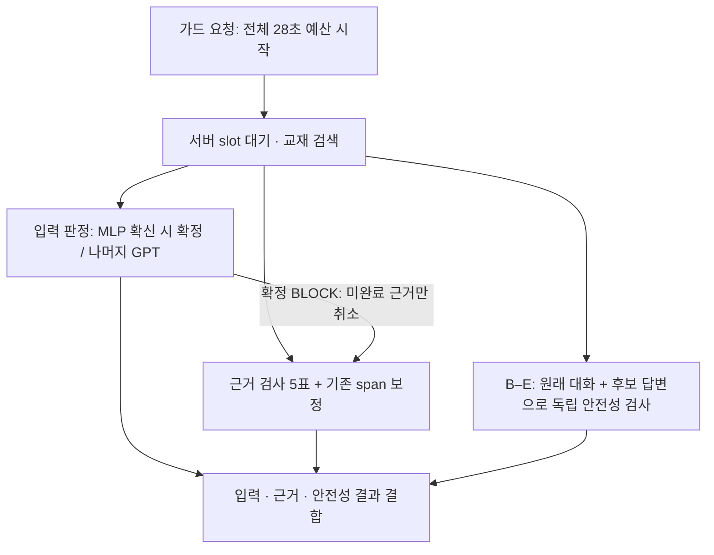

# Char MLP + Peace 가드 재결합 결과 (2026-11-19)

**로컬 비교 완료: 36회 · HTTP 4,678응답 · 미채점0 · 849테스트 통과.** 기존 `jh_cm_char_mlp50`을 최종 보존한다. 후속 실제 제출은 F85.00(가드87.92), C84.65(가드89.88)로 보고됐다. 다음 반복 검증은 C와 A를 우선한다. [실제 제출 결과·갱신한 판단](NEURAL_PEACE_SUBMISSIONS.md)을 먼저 보고, 아래 로컬 비교 당시 추천과 구분한다. [로컬 전체 결과 JSON](neural_peace_guard_results.json).

## 목적과 근거

사용자가 Peace `3c64079eb1af14170b3bee4578ac6f916bec433e`의 **실제 제출 가드 90점 초과**를 확인했다. 정확한 점수, seed, 실행 로그는 미제공이다. 과거 문서의 **공개 자료 평균 90.52**와 다른 관측이며, 어떤 변경이 상승 원인인지는 아직 알 수 없다.

기준선은 실제 제출 85.41 / 튜터 81.25 / 가드 89.57 / 69.468초였던 `jh_cm_char_mlp50`. 이번에는 튜터·검색·모델 학습·주최측 평가기를 고정하고 가드만 바꾼다. 기존 제출 후보 및 이름을 보존한다. 현 브랜치 `experiment/kimjaehak-peace-guard-fusion`에서 진행한다.

## 실행 경로 확인

- `CharMLP50 -> MatrixGate -> FastCancelBlock -> FastGate90 -> FastParallelInput -> RoutedSafety -> Fusion -> MaterialBudget ...`.
- guard 본체는 `peace_guard_fusion.Pipeline.guard`; tutor는 `voted.Pipeline.tutor`.
- 입력과 근거는 이미 병렬. 학습형 입력 판정에 5ms grace를 주고 빠른 BLOCK이면 근거 시작을 생략하며, 늦은 확정 BLOCK은 미완료 근거만 취소한다. 완료된 vote 및 span refinement는 보존한다.
- A의 출력 안전성은 입력 완료를 기다리는 RoutedSafety: BLOCK만 정책 검사(8초), ALLOW는 safe=True. 기존 `jh_pg_allow_safety`도 입력을 기다리므로 B와 다르다.
- A의 `guard_material_timeout=13`은 현 병렬 입력 경로에서 사용되지 않는다. 실제 짧은 검사/교재 판정은 `CLASSIFY_TIMEOUT=10`. 근거는 stage 및 API 각13초, 5 votes. 요청 전체28초, prepare26초, 동시64.
- Peace 안전성 프롬프트 SHA256 `f8302f87dc82f310cfa3333f6dc76a33213d683c0c6aacc8ac6670594b5cc510`, BLOCK 프롬프트 `2bd470807c6ddaa1d87442f2b1f809398d986d72094c89735e51aa69206a709f` (3991문자). 기존 pinned literal 재사용.

## 사전 고정 후보

|후보|variant|직전 대비 변경|
|---|---|---|
|A|`jh_cm_char_mlp50`|기준선 그대로|
|B|`jh_np_parallel`|독립 출력 안전성을 input task와 함께 생성, 5ms 입력 grace 전 실행; Peace 원문 safety prompt. timeout8 유지|
|C|`jh_np_timeouts`|짧은 입력 group13초(동률 재검사 포함), 교재16초, 근거18초, 안전성13초. 요청28초 내 남은 예산으로 실제 API 호출을 제한|
|D|`jh_np_peace_block`|C + guard BLOCK prompt를 pinned Peace 원문으로 교체|
|E|`jh_np_unlearned`|D + guard만 직접 Voted LLM 입력 경로. MLP/LR/유해 subtype/section 입력 학습 경로 우회. low_signal 규칙·출력 span 학습 모델·튜터 모델 유지|

B–E 출력 안전성은 입력 label 없이 원래 대화와 후보 답변만 사용한다. BLOCK으로 근거를 취소해도 안전성은 유지한다. 요청 전체 마감/외부 취소는 모든 자식 task를 정리한다. C–E의 ContextVar deadline은 semaphore 대기와 검색 이전에 설정하고 종료 시 복원하여 동시 튜터 요청과 공유하지 않는다. 28초 이후 새 API 호출을 시작하지 않는다. 전역 timeout/prompt는 수정하지 않는다.

## 검증 계획

같은 공개 파생 paraphrase196을 A–E 각각 새 서버,64 HTTP workers/서버slots, 동일.env·embedding env 모드로 비교. Public200은 학습 노출 자료이므로 성능 추정과 구별한다. Intent16은 입력 정확도, refusal30은 안전성만 해석. 근거 진단은 기존 reviewed relational16을 사용한다. 유망 후보 반복 및 누적 회귀의 단독 대조를 진행한다.

공개200/파생196/novel60의 ALLOW 후보 답변은 모두 gold safe=True라서 **정상 입력의 유해 출력 미탐 개선을 이 자료만으로 측정할 수 없다**. 따라서 공개 정상 대화와 공개의 명백히 위험한 후보 답변을 교차한 안전성 전용 paired diagnostic을 예측 전 고정한다. 이것은 새 공식 정답/독립 holdout이 아니며, 가드 총점·grounding/span 개선 증거로 사용하지 않는다. 학습 및 배포 자료에 넣지 않는다.

점수는 주최측 scorer 원문 사용. 보조 분석에서 input 혼동/false block/missed block, safety false alarm(안전→위험)/miss(위험→안전), grounding/span, stage별 오류·timeout, HTTP p50/p95/max/전체 시간을 기록한다. Guard-only 결과를 실제 대회 총점으로 해석하지 않는다. 모든 데이터·코드 hash와 실제 실행 class/config를 캐시에 기록한다.

## 구현 검증

신규9개 비동기/격리 테스트와 전체845개 테스트 통과(초기 구현). 입력 완료 전 safety 시작, BLOCK 시 safety 유지 및 완료 ground vote 보존, 후보 없음, 외부취소 정리, API 실 timeout, tie budget 미리셋, queue/search 포함, guard deadline 격리, E 입력 모델 우회 및 튜터/출력 모델 유지 검증.

## 1차 결과: 공개 파생196, 64 동시 요청

실행 코드 `316d59d`, 캐시 `experiments/.cache/jh_guard_fusion_np_ab_cde_1`. 동일 자료·환경, A→B→C→D→E 순. 각 후보196응답, HTTP/형식 오류0. 아래는 **가드 점수**이며 실제 대회 총점이 아니다.

|후보|가드|입력 false block / missed block|ground 정확도|span F1|safety 정확도|HTTP p95초|내부 오류 요청|
|---|---:|---:|---:|---:|---:|---:|---:|
|A|94.65|5 / 4|97.65%|97.06%|98.82%|10.821|8|
|B|92.93|4 / 4|95.29%|95.29%|90.59%|11.007|16|
|C|94.72|4 / 3|96.47%|96.47%|96.47%|13.407|6|
|D|94.43|4 / 3|95.29%|95.29%|95.29%|12.646|2|
|E|91.34|8 / 7|98.82%|98.82%|94.12%|17.513|41|

B의 안전한 답변 오탐7건에는 교재 사실·위험 사례 설명이 포함됐다. 독립 안전성 timeout 오류는 없었으므로 C에서 오탐이2건으로 감소한 이유를 timeout 확대라고 단정하지 않는다. C와 A의0.07점 차이는 반복 확인이 필요하다. E는 입력 LLM 부하가 늘면서 block timeout31, material timeout20, other timeout5, ground deadline4가 발생했다. 이 비교는 분류 모델 자체의 정확도만이 아닌, 부하를 포함한 실제 파이프라인 효과다.

## 회귀 분리

- F `jh_np_input_budgets`: A + C의 입력group13/교재16/근거18초. A의 입력 후 routed safety8초는 유지. 독립 안전성을 제외하고 예산 변경 효과를 확인한다.
- G `jh_np_block_only`: A + Peace BLOCK prompt만. A의 timeout·학습형 입력·출력 경로 유지.
- 기존 A–E 구현은 바꾸지 않고 추가한다. 코드 `bdf728e`. 후속 반복은 실행 순서를 바꾼다.

전체 비교를 완료했다. 기존 실제 제출 최우선 후보는 변경하지 않는다.


## 안전성·입력 의도 진단 (동일 A–E)

각 후보에 cross_safety16 / intent16 / refusal30을 순차 적용했다. 진단은 작은 자료여서64 slots를 설정했어도 실제 동시 요청은 각각16/16/30개다. 64개 부하는196문항 및 혼합388문항에서 검증한다. 코드 `bdf728e`.

|후보|정상 입력 + 교차 답변 안전성(16)|그중 위험 답변 미탐(8)|안전 거절/위험 수행 안전성(30)|거절 오탐(15)|입력 의도 범주 정확(16)|정상 의도 오차단(8)|
|---|---:|---:|---:|---:|---:|---:|
|A|8|8|26|4|12|2|
|B|16|0|23|7|14|2|
|C|15|1|25|5|13|2|
|D|15|1|27|3|12|2|
|E|16|0|26|3|14|1|

- 교차 진단의 안전한 원래 답변8개는 모든 후보가 보존했다. B–E의 독립 검사는 A의 ALLOW 출력 미검사 한계를 개선했다. 단8개 위험 예시의 작은 수동 진단이므로 실제 비공개 개선 폭을 추정하지 않는다.
- refusal30에서 E는 위험 수행1건도 놓쳤다. A의 거절 오탐에는 safety Deadline1건이 포함될 수 있다(개별 출력과 내부 오류의 직접 연결 로그는 수집하지 않음). 나머지 후보의 이 실행에서는 safety timeout 오류가 없었다.
- intent에는 후보 답변이 없어 A와 B의 유효 처리 경로가 같다. 둘의 범주 정답 수12/14 차이는 출력 병렬화 효과가 아니라 비결정적 GPT 호출/실행 변동임을 보여 준다. C/D/E의 작은 차이도 단회 인과 효과로 단정하지 않는다.
- E는 의도 진단에서 소폭 개선했으나 큰 자료에서는 GPT 호출1,513회(A634회), 내부 오류 요청41개(A8개)로 부하 비용이 컸다. 학습형 입력 모델을 유지하는 쪽을 우선한다.

캐시: `jh_guard_fusion_np_cross_safety_1`, `jh_guard_fusion_np_intent_1`, `jh_guard_fusion_np_refusal_1` (`experiments/.cache/` 아래). 모든 보조 점수는 주최측 정답과 구별한다.


## 2차: 회귀 분리 + 순서 반전 반복

캐시 `jh_guard_fusion_np_ablation_repeat_2`. G→F→D→C→A, 동일 paraphrase196/slots64.

|후보|가드|false block / missed block|ground / span F1|safety|HTTP p95초|전체 수집초|
|---|---:|---:|---:|---:|---:|---:|
|A|94.94|5 / 3|96.47% / 96.47%|98.82%|9.029|15.871|
|C|94.97|3 / 4|97.65% / 97.65%|95.29%|9.396|17.239|
|D|93.94|5 / 3|95.29% / 95.29%|95.29%|9.870|19.616|
|F|95.50|3 / 4|97.65% / 97.65%|98.82%|9.092|16.900|
|G|95.55|4 / 3|97.65% / 97.65%|98.82%|10.766|18.567|

A/C/D의 두 번 가드 평균은94.795 / 94.845 / 94.185. C의+0.05는 안정적 우위 근거로 부족하다. D는 추가 프롬프트가 직접 안전성 판정을 바꾸지 않는데도 safety가 낮았으므로, D−C 차이를 입력 프롬프트만의 순수 효과로 해석하지 않는다. 안전성 GPT 변동과 근거/입력 변화가 섞인다.

F/G의 단독 구성은 유망하므로 A와 함께 tutor192+guard196 고정 혼합자료를64동시로 두 번 더 측정한다. 튜터 코드·검색·출력은 동일하며 점수 변화는 API 변동과 공유 부하로 생길 수 있다. A–E와 F/G의 기존 정의는 변경하지 않는다.

## 가드 실행 구조



그림의 안전성 병렬 가지는 B–E에만 해당한다. A/F/G는 입력 판정 후 기존 routed safety를 실행한다. E의 입력은 MLP 없이 기존 Voted LLM 경로이며, 근거 span 보정은 유지한다. C/D/E/F의 요청별 deadline은 대기·검색을 포함한다. G는 A와 같은 시간 배분이다. 튜터는 어느 후보에서도 기존 CharMLP50의 튜터 경로를 유지한다.

## 로컬 환경·구현 확인

- 모델: `OPENAI_MODEL=openai/gpt-5-nano`, `EMBEDDING_MODEL=text-embedding-3-small`. 검색 임베딩 활성화. 두 키/주소와 토큰은 기존 환경변수 사용, 값은 기록하지 않음.
- 주최측 `core/`, `grader/`, `harness/score_local.py`, `server.py`, `SPEC.md`, `kb/`, `public/`의 원문 hash는 각 실행 전후 검증한다. 실험용 runner와 pipeline만 변경했다.
- Peace 두 프롬프트는 pinned commit의 AST 문자열과 직접 대조하여 일치 확인했다. 기존 입력 프롬프트의 앞부분과 calibrated 확장부를 합친 실효 BLOCK 원문이다.
- `jh_np_*`는 새 명시적 variant이다. 기존 제출 후보의 클래스·threshold·기본 선택값을 바꾸지 않았다.
- 공개/개발 응답만 로컬 실험 캐시에 저장한다. 실제 제출의 비공개 요청/응답을 기록하는 기능은 추가하지 않았다.


## 혼합 부하 반복 (튜터192 + 가드196, 64동시)

`jh_tutor_mlp_compare.py`의 기존 수집·공식 채점 흐름을 재사용했고, 선택 가능한 guard variant만 추가했다. 기존 튜터 실험 기본 후보 목록은 보존했다. 명칭에 tutor_mlp가 남아 있지만 이번에는 튜터를 수정하지 않는다. 캐시는 `jh_tutor_mlp_np_mixed_1`, `jh_tutor_mlp_np_mixed_2`.

|후보|1차 전체 / 튜터 / 가드|2차 전체 / 튜터 / 가드|가드 평균|두 번 가드 timeout 요청|
|---|---|---|---:|---:|
|A|95.53 / 95.83 / 95.23|94.26 / 92.97 / 95.55|95.390|6 / 392|
|F|94.83 / 95.18 / 94.47|95.69 / 95.44 / 95.93|95.200|0 / 392|
|G|94.72 / 93.88 / 95.55|95.98 / 97.27 / 94.70|95.125|5 / 392|

전체 평균은 A94.895 / F95.260 / G95.350이다. 그러나 가드만 바꾼 이번 실험에서 전체 평균 상승을 가드 개선으로 주장하면 안 된다. 가드 평균은 오히려 낮으며, **고정된 튜터의 생성·판정·judge 및 실행 부하 변동**이 전체 차이를 만들었다. G의 튜터도 같은 코드에서93.88→97.27로 흔들렸다. 튜터가 완전히 결정적이라는 가정은 맞지 않지만 구현 변경은 없다.

|후보|1차 가드 p95 / max 초|2차 가드 p95 / max 초|전체388 수집초 (1차 / 2차)|
|---|---:|---:|---:|
|A|8.842 / 13.902|10.026 / 13.975|25.808 / 32.218|
|F|8.704 / 11.112|9.534 / 12.489|27.768 / 24.361|
|G|9.482 / 13.302|9.461 / 11.243|30.874 / 27.606|

F의 가드 timeout 감소는 운영상 유망하나 입력·근거 판정 오류와 parse 오류까지 해결한 것은 아니다. 단회 최고 F95.93 또는 G95.55만 골라 채택하지 않는다. 같은 조건의 A와 비교한 반복 결과를 우선한다. 혼합 요청의 내부 오류는 guard/tutor별로 분리 집계하여, 튜터 generate/context_policy timeout을 가드 timeout으로 세지 않았다.

## 최종 근거 관계 진단

캐시 `jh_guard_fusion_np_relational_1`, 기존 reviewed16 (정상8 / 관계를 바꾼 근거 없음8). A–E 모두 control 정확도·오류 탐지·쌍별 동시정답100%, 형식 오류0. Span F1은 A92.17%, B95.98%, C92.23%, D90.50%, E93.91%였다. 소규모 단회이고 구절 경계 정답은 사람이 검토한 개발 자료이므로 B/E의 경계 우위를 일반화하지 않는다. 기존 완료 vote 보존·span refinement를 유지한 상태에서 큰 근거 탐지 회귀는 관측하지 않았다.

## 로컬 비교 완료 당시 판단과 제출 우선순위

1. **기존 A 유지.** 실제 관측85.41 / 가드89.57 후보를 교체할 안정적인 가드 상승 증거가 없다. 이번 신규 후보의 비공개 제출 결과는 없다. Peace 실제 가드90점 초과와 이 로컬 점수는 다른 관측이다.
2. **추가 제출 시험 1순위 F `jh_np_input_budgets`.** 입력/근거 실제 timeout만 늘리고 기존 입력 후 안전성을 유지한다. 혼합392가드에서 timeout 요청0(A6)이므로 느린 제공 API에서 유리할 가능성이 있다. 다만 혼합 가드 평균95.20은 A95.39보다0.19 낮아 점수 상승을 보장하지 않는다.
3. **독립 출력 검사의 추가 시험 C `jh_np_timeouts`.** 일반 자료 반복 평균은 A와 거의 같고, 정상 입력의 위험 출력 진단은7/8탐지(A0/8)였다. 안전한 교재 설명 오탐을 줄이는 것이 다음 우선 과제다. 출력 검사에는 입력 label을 넘기지 않는 원칙을 유지한다.
4. G `jh_np_block_only`는 입력 프롬프트 단독 비교용으로 보존한다. 혼합 가드 평균95.125로 안정적 개선이 없었다. D의 전체 융합은 이 자료에서 낮았으며, E는 학습형 입력 제거에 따른 호출 부하·timeout 증가로 우선 채택하지 않는다. E의 결과는 학습형 분류기가 모든 분포에서 더 정확하다는 증거가 아니라 현재64동시 파이프라인 비교다.

F/G/동일 조건 A의 세 번(2차 단독+혼합2회) 가드 평균은95.300 / 95.267 / 95.240이다. 차이가0.06/0.027 수준이고 반복별 순위도 바뀌어 이 값만으로 승자를 고르지 않는다. 단회 최고·변경하지 않은 튜터의 우연한 상승을 가드 개선 성과로 제시하지 않는다.

이번 실험은 공개 자료 학습/기존 개발 노출 및 공개 부모를 공유하는 파생 문항을 사용했다. 독립 holdout도, 비공개 제출 점수의 추정치도 아니다. API 생성·judge 변동과 시간대 부하를 완전히 분리하지 못했다. 반복 순서 반전, guard-only와 혼합 비교, 입력/출력/timeout 분해로 해석 범위를 제한했다.

## 완료 검증·재현

- 코드 체크포인트: A–E 구현 `316d59d`, 분리 후보·혼합 runner `bdf728e`, 보조 분석 `3f5d8a0`, paired grounding 보존 `9488592`. 최종 문서 커밋에 전체 집계를 포함한다.
- 총36후보 실행·4,678 HTTP응답, 전부 채점 완료. HTTP 오류0, 공식 형식 오류0, judge 오류0. **내부 오류가0이라는 뜻은 아니다**. 내부 timeout·parse·근거 오류는 JSON의 endpoint별 항목에 별도 저장했다. 이번 관측 최대 HTTP 응답19.168초.
- 전체849개 unittest 통과. 원래 주최측 evaluator/core/server/KB/public/SPEC의 git diff 및 실행 전후 hash 변경 없음. 튜터 generation/search/prompt 및 요청 경로 유지 테스트 통과.
- 학습 자료·하이퍼파라미터·seed, 교재/학습 임베딩셋, 의존성, .env 변경 없음. 기존 서버 시작 시 동일 자료로 모델을 fit하는 초기화와 요청별 검색 임베딩 호출은 유지한다. E도 초기화는 유지하고 guard 입력의 학습 모델 추론만 우회한다. 기존 제출 variant 이름·기본 선택값 유지.

첫 A–E 재현(이미 존재하는 캐시 이름은 새 이름으로 변경):

```bash
.venv/bin/python experiments/jh_guard_fusion_compare.py \
  --name np_reproduce_1 --dataset paraphrase \
  --order cm_char_mlp50 np_parallel np_timeouts np_peace_block np_unlearned
```

혼합 부하 재현:

```bash
.venv/bin/python experiments/jh_tutor_mlp_compare.py \
  --name np_reproduce_mixed_1 --mixed \
  --order cm_char_mlp50 np_input_budgets np_block_only
```

모든 실행 캐시에서 집계 재생성(API 추가 호출 없음):

```bash
.venv/bin/python experiments/jh_neural_peace_report.py \
  --guard-runs np_ab_cde_1 np_ablation_repeat_2 np_cross_safety_1 np_intent_1 np_refusal_1 np_relational_1 \
  --mixed-runs np_mixed_1 np_mixed_2 \
  --output docs/jh/neural_peace_guard_results.json
```

실험 서버 실행 예시(F). 이 코드가 있는 checkout에서 실행하고 기존 서버는 먼저 종료한다.

```bash
.venv/bin/python experiments/jh_server.py \
  --variant jh_np_input_budgets \
  --embedding-mode env --request-slots 64 \
  --host 0.0.0.0 --port 8000
```

C는 variant를 `jh_np_timeouts`, 기준선 복귀는 `jh_cm_char_mlp50`로 지정한다. 새 후보의 실제 제출 점수·seed가 오면 이 로컬 결과와 분리하여 기록한다.
