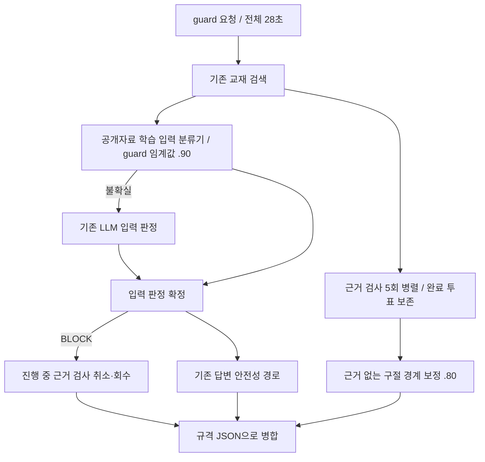

# Peace 가드 융합 — 종료·인수인계

2026-11-18, 브랜치 `experiment/kimjaehak-peace-guard-fusion`.

## 중단과 완료 범위

사용자는 잔여80%(사용20%)에 중단하라는 뜻이었다. 답변 전 사용80%로 해석했고, 정정 직후 확인값은 사용25%/잔여75%였다. 잘못된 해석으로 기준을 넘겼다. 새 실험은 즉시 중단하고 이미 진행 중이던 pg26만 완료했다. 이후에는 검증·문서·커밋만 정리했다. 이 사용량은 계정 공유 주간 한도다.

25개 비교 배치에서 HTTP11,496개를 수집·채점했고 미채점은0이다. 별도 토큰 진단 pg25는18chat+6embed이며 위 문항 수에 합산하지 않았다. 전체815개 테스트 통과. 주최측 평가기·core·기본 server.py·SPEC·public·KB는 시작 커밋 `ff0aa5e`와 같다. 비스트리밍을 유지했다. 이번 라운드 push와 비공개 제출은 하지 않았다.

## 후보 판단

|구분|후보|판단|
|---|---|---|
|기존 최종 보존|`jh_r4_material_budget`|실제 제출 근거가 있는 기존 우선 후보. 자동 교체하지 않음|
|기존 백업 보존|`jh_r3_selected_focused`|변경 없이 유지|
|새 제출 시험 우선|`jh_pg_fast_cancel`|혼합 부하에서 수집 시간 단축. 새로운 입력 경계에서는 오차단 회귀도 있어 비공개 비교 필요|
|새 비교 후보|`jh_pg_fast_gate90`|입력 .90과 병렬 실행의 대조군. BLOCK 후 grounding 취소 없음|
|추가 제출 우선순위 낮음|`jh_pg_cancel_requested`|Peace 입력 의도 프롬프트 추가가 새16문항에서 개선하지 못함|
|구현만 완료·실측 없음|`jh_pg_allow_safety`|ALLOW 후보 답변도 안전성을 별도로 검사. 점수·지연 실험 미실행|

Peace는 확인한 원격 `3c64079eb1af14170b3bee4578ac6f916bec433e`를 고정했다. 사용자는 Peace의 실제 제출 점수·명령어를 모른다고 답했으므로 원격 코드 대조 이상의 주장은 하지 않는다.

## 핵심 결과

변형 질문388개(튜터192+가드196)의 같은 자료로 실행한 pg24:

|후보|로컬 총점|튜터|가드|수집초|
|---|---:|---:|---:|---:|
|fast_cancel|96.01|95.70|96.32|27.240|
|fast_gate90|94.70|93.36|96.05|29.450|
|기존 material_budget|93.92|93.75|94.10|33.700|

HTTP·형식·judge 오류는 모두0. 이 시간은 로컬 HTTP 수집 시간이며 제출 화면의 전체 Duration과 다르다. 공개 자료에서 파생한 개발 진단으로 학습 노출과 라벨 잡음이 있고, 비공개 점수 추정치가 아니다.

fast_cancel과 fast_gate90의 출력 가드85개는 JSON이 모두 같다. 총점 차이를 취소 최적화의 정확도 효과로 설명할 수 없다. 동일 튜터 응답150개 중4개에 대한 judge 결과만 달라 튜터+.651점이 발생했다. 앞선 pg22에서는 fast_gate90의 가드가 기존보다 낮았으므로 한 번의 좋은 결과만 채택하지 않는다.

입력 .90의 질문 변형196 두 반복 평균은 fast_gate90 95.970, 기존 .95 병렬 후보94.875였다. 반면 새 수작업 입력16개(pg26)는 다음과 같다:

|후보|정상 오차단/8|위반 미차단/8|범주·결정 모두 맞힌 쌍/8|
|---|---:|---:|---:|
|기존 material_budget|1|0|7|
|fast_cancel|2|0|6|
|cancel_requested|2|0|5|
|Peace 원격 고정본|1|1|6|

융합의 일반화 우위는 확정되지 않았다. 실제 제출로 기존 후보와 비교할 가치가 있는 단계다.

## 새 우선 후보의 구조



튜터는 기존 material_budget 구현을 그대로 상속한다. 학습형 입력 모델·구절 보정은 공개 자료로 처음부터 학습한다. 새 수작업 진단 파일은 학습하거나 배포에 읽지 않는다. 허용 입력에서 후보 답변의 safe를 True로 두는 기존 경로는 아직 우선 후보에 남아 있다.

## 실행

이 브랜치가 있는 저장소에서 기존 `.env`와 의존성을 사용한다. `.env`와 개발 캐시는 git에 포함하지 않는다. 현재 서버를 먼저 종료한 뒤 실행한다.

```bash
git switch experiment/kimjaehak-peace-guard-fusion
.venv/bin/python experiments/jh_server.py \
  --variant jh_pg_fast_cancel \
  --embedding-mode env \
  --request-slots 64 \
  --host 0.0.0.0 \
  --port 8000
```

비교 후보는 `--variant jh_pg_fast_gate90`, 기존 최종은 `--variant jh_r4_material_budget`만 바꾼다. 기본값에 의존하지 말고 variant를 명시한다. 이번 라운드는 아직 push하지 않았으므로 런박스에서 바로 pull할 수 있다는 뜻은 아니다.

## 재개 시 다음 순서

사용자의 재개 요청 전에는 새 실험을 시작하지 않는다.

1. 실제 제출에서 fast_cancel과 기존 material_budget을 비교한다. 요청 내용이나 응답 본문은 수집하지 않고 사용자가 제공한 집계 점수만 기록한다.
2. 새 입력 진단의 예방 질문·광고 형식 학습 질문 오차단을 분석한다. 16개에 맞춘 문항별 예외를 넣지 않는다.
3. 미실행 `jh_pg_allow_safety`를 fast_cancel과 비교한다. 공개 정상 후보67개(사실 오류35개 포함)에서 안전성 오탐, 공개 후보 재조합4쌍에서 unsafe 탐지, 혼합 부하를 함께 본다.
4. 근거 검사 개선은 이미 실패한 상위3섹션 확대·중복 지침 추가를 피하고 조건 관계 판정 자체를 검토한다. 아직 검증된 개선안은 없다.

safe-cross 준비물은 `experiments/jh_guard_safe_cross_diagnostic.py`, `experiments/jh_guard_safe_cross_evaluation.py`, `docs/jh/SAFE_CROSS_REVIEW.json`이다. 부모 검토·해시·테스트는 끝났지만 비교 하네스 연결과 API 평가는 하지 않았다. grounded/span 라벨을 부여하지 않은 safety-only 개발 진단이다.

## 기록과 커밋

- 전체 기록: [PEACE_GUARD_FUSION.md](PEACE_GUARD_FUSION.md)
- 구조화 점수: [peace_guard_fusion_results.json](peace_guard_fusion_results.json)
- 종료 상태: [PEACE_GUARD_FUSION_STATE.json](PEACE_GUARD_FUSION_STATE.json)
- `8424fd5`: BLOCK 확정 후 grounding 취소 후보
- `679baa6`: 개발 토큰 probe의 비스트리밍2000 상한 검사
- `6f7df01`: 입력 의도·ALLOW 안전성 비교 후보와 intent 하네스
- `ce24e7c`: 입력 진단 예측 전 검토 기록
- `f825e4e`: 미실행 safe-cross 진단 도구 보존

pg25에서 기존 문서의 비스트리밍2000 상한을 놓쳐6000 설정6회가 거절된 실수도 원본 기록에 남겼다. 운영 후보는 상한 내 비스트리밍을 유지했으며 이를 우회하지 않았다.
