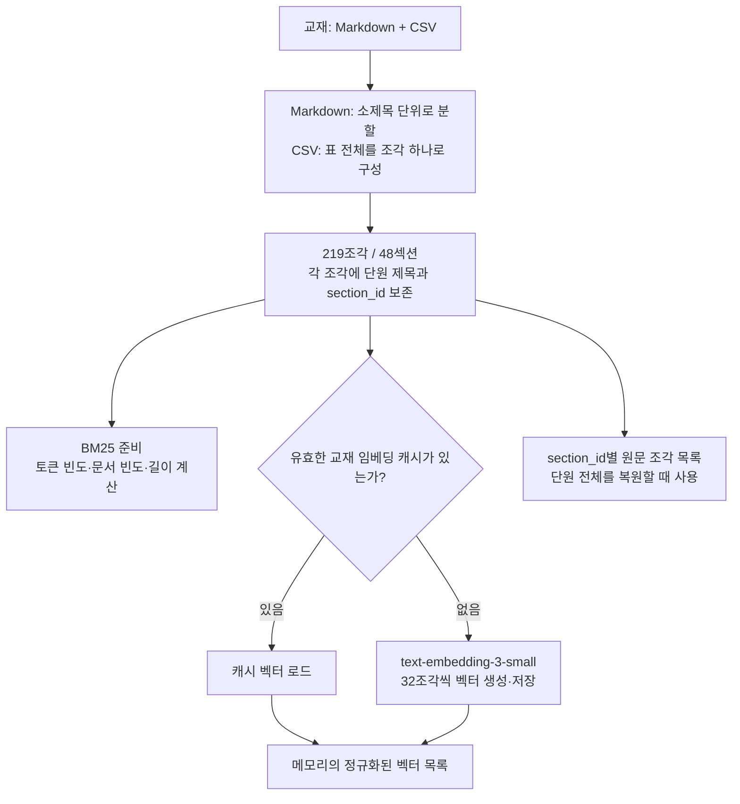
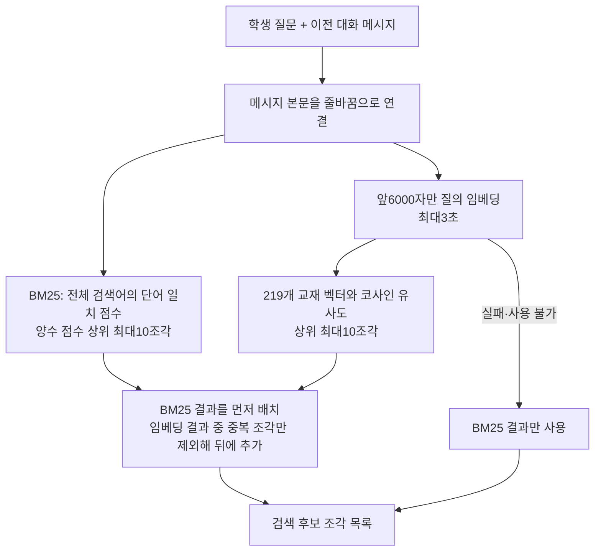
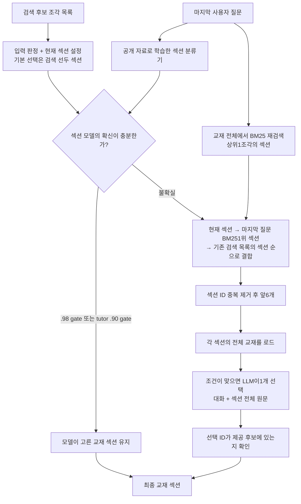
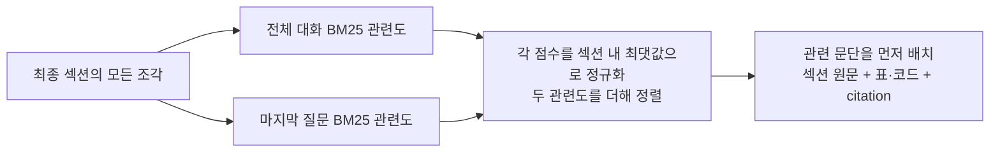

# 최종 후보의 교재 검색 구조

대상은 최종 우선 후보 `jh_r4_material_budget`와 백업 `jh_r3_selected_focused`다. 두 후보의 검색·출처 선택·문단 재정렬은 동일하며 시간 배분만 다르다. 아래 요청 흐름은 정상/PII 학습 질문의 `/tutor` 경로를 중심으로 그렸다. 별도 `/guard`는 후보 답변도 검색어에 추가할 수 있으며 튜터의 출처 선택 경로와 구분한다.

## 1. 서버 시작: 교재를 두 검색 방식으로 준비

현재 저장소 교재를 코드로 읽으면 48섹션·219조각이며, 그중 CSV 표 조각은23개다. 과목은 finance/prompt/python이다. 섹션은 인용할 단원 ID이고 조각은 검색할 소단원 본문 또는 표다.



고정 글자 수로 무작위 분할하지 않고 `##` 소제목을 기준으로 나눈다. 표는 개별 CSV 전체를 보존한다. 같은 자료의 HTML은 중복 색인하지 않는다. BM25의 한글 토큰은 겹치는 두 글자 조합, 영문·숫자는 정규식 단위다. 예를 들어 `가입조건 sort() 12개월`은 `가입 / 입조 / 조건 / sort / 12 / 개월`이다. Kiwi는 현재 검색기에 사용하지 않는다.

임베딩 캐시는 모델 이름과 조각 텍스트의 해시로 조회한다. 설정이 없거나 생성에 실패하면 BM25만 사용한다. 벡터는 외부 벡터 DB가 아닌 로컬 메모리 목록이며, 요청 시 모든 조각과 유사도를 계산한다.

## 2. 요청: 전체 대화로 후보 조각 검색



그림은 두 검색 방식의 데이터 흐름이다. 실제 구현은 질의 임베딩을 기다린 뒤 `Searcher.search` 안에서 BM25 점수와 벡터 유사도를 순서대로 계산하며, 두 모델 API를 병렬 호출하는 그림이 아니다. 질의 임베딩 호출은1회다. BM25에는 전체 문자열, 임베딩에는 앞6000자가 전달되므로 매우 긴 대화에서는 두 경로가 보는 범위가 다를 수 있다.

BM25 점수는 단어 빈도·희소성·문서 길이를 반영한다. 임베딩은 길이를 정규화한 벡터의 내적으로 코사인 유사도를 계산한다. 임베딩 상위10개에는 별도의 최소 유사도 문턱을 두지 않는다.

결합 예시(설명을 위한 가상 조각):

```text
BM25 순위:     A-1 → B-1 → A-2 → C-1
임베딩 순위:  B-1 → D-1 → A-1 → E-1
결합 결과:    A-1 → B-1 → A-2 → C-1 → D-1 → E-1
```

중복 제거의 기준은 조각이다. 같은 섹션의 서로 다른 조각 A-1/A-2는 여기서는 둘 다 남는다. BM25 점수와 임베딩 점수를 더하거나 RRF로 재정렬하지 않는다. 순위에 따라 최대20조각이지만 중복이나 BM25 양수 결과 수에 따라 더 적을 수 있다.

## 3. 후보 조각에서 답변할 단원 하나 선택

검색 뒤 입력 판정에서 근거 존재 여부와 범주를 정한다. 확신이 높은 경량 분류 경로에서는 LLM 입력 검사를 생략할 수 있다. 아래는 정상/PII 학습 질문에서 사용할 섹션을 결정하는 구조다.



섹션 분류기는 마지막 사용자 질문의 문자 TF-IDF 특징과 로지스틱 회귀를 사용한다. .98/.90은 모델의 예측 확률 문턱이며 실제 정답률 보장은 아니다. 현재 WholeKB 상속 설정에서는 고신뢰 선택이 처음 검색된 조각 목록 밖의 교재 섹션을 가리킬 수도 있다. 따라서 전체 구조를 단순히 '20조각의 부분집합6개에서1개'로 설명하면 정확하지 않다.

불확실한 경우의 실제 순서는 다음과 같다.

```text
[현재 section_id]
+ [마지막 사용자 질문만으로 검색한 BM25 1위의 section_id]
+ [전체 대화 검색 결과들의 section_id, 기존 순서]
→ 같은 section_id 중복 제거
→ 앞에서 최대6개
```

최대6개는 조각 수가 아니라 섹션 수다. LLM에는 검색에 걸린 조각만 보내지 않고 해당 섹션의 전체 본문·표를 보낸다. 같은 후보가 둘 이상이고 남은 시간 여유가 있을 때만 출처 선택을 호출한다. 설정은 제공 LLM, low, 최대2000토큰, 최대8초이며 전체26초의 남은 시간에 의해 더 짧아질 수 있다. 출력은 `section`과 `reason` JSON이고, 현재 최종 후보는 이를 비스트리밍으로 받는다.

후보가 하나뿐이거나 시간이 부족하면 현재 선택을 유지한다. 호출·파싱·ID검증이 실패해도 기존 섹션을 유지한다. 정상/PII 이외의 질문과 guard 요청에는 이 튜터 전용 선택 절차를 적용하지 않는다. source ID 검증은 해당 섹션이 실제 질문의 답을 담고 있음을 결정적으로 증명하는 검사는 아니다.

## 4. 선택한 섹션 내부의 문단 순서 결정



전체 대화와 마지막 질문이 같으면 같은 질의를 두 번 가산하지 않는다. 낮은 관련도의 문단을 여기서 버리는 방식이 아니라 섹션 내부의 모든 조각을 재배열한다. 한 섹션 내 문단 순서를 정하는 단계이며 다른 섹션들을 섞지 않는다. 정상적인 주 경로에서는 이 원문 인용 뒤 자유 생성 LLM을 다시 호출하지 않는다. 교재가 없거나 응답4000자 제한을 넘으면 기존 생성 경로로 복구한다.

## 현재 구조에서 눈여겨볼 점

- 임베딩에서 좋은 섹션을 찾아도 앞선 BM25 섹션들이6자리를 차지하면 최종 LLM 선택 후보에 들어가지 않을 수 있다. 임베딩이 켜졌다는 사실만으로 답변에 기여했다고 볼 수 없다.
- 여러 조각을 찾는 것과, 질문의 대상·조건에 맞는 섹션 하나를 고르는 것은 별개다. 이름이 같은 실습을 혼동하면 교재 원문을 정확히 인용해도 질문의 정답이 아닐 수 있다.
- 입력 판정의 교재 확인과 뒤의 출처 선택은 다른 단계다. material_budget의13초는 앞의 교재 확인에만 해당하며 여기의 검색 방식이나 출처 선택8초를 바꾸지 않는다.

코드 근거: [교재 분할](../../core/kb.py), [검색과 후보 결합](../../core/search.py), [질의 생성](../../pipelines/v1/pipeline.py), [출처 후보6개와 선택](../../pipelines/kimjaehak/source_extract.py), [문단 재정렬](../../pipelines/kimjaehak/focused_excerpt.py). 이번 작업은 읽기와 설명 문서 작성이며 실행 코드·모델 호출·제출에는 변경이 없다.

## 임베딩 조각 길이 실측과 판단 — 2026-11-17

`core.kb.load_chunks('kb')`의 `len(chunk.text)`로 확인했다. 제목·소제목·공백·줄바꿈을 포함한 Python 문자열 문자 수이며 토큰 수가 아니다. 임베딩은 이 조각 텍스트 전체를 사용한다. 고정 토큰 길이나 sliding overlap 설정은 없고, 단원 제목이 각 조각에 반복된다.

| 구분 | 조각 수 | 평균 문자 | 중앙값 | 95백분위 | 최대 |
|---|---:|---:|---:|---:|---:|
| 전체 | 219 | 473.8 | 454.0 | 804.5 | 2,095 |
| 본문·코드 | 196 | 509.7 | 467.5 | 809.8 | 2,095 |
| CSV 표 | 23 | 168.0 | 152.0 | 250.4 | 467 |

전체 최솟값69자, 중간50%는348.5~585자, 300~800자 조각169개, 1,000자 초과5개, 100자 미만5개다. 백분위는 정렬된 길이에서 선형 보간했다. Q&A를 포함한 조각은24개다.

| 긴 조각의 섹션 | 소제목 | 문자 수 | 포함된 Q&A |
|---|---|---:|---:|
| FIN-03-03 | 손쉽게 결제하기 전에 | 2,095 | 8 |
| FIN-04-02 | 거래 전에 먼저 멈추기 | 2,076 | 6 |
| FIN-04-04 | 급하게 필요한 돈, 어떻게 구할까요? | 1,737 | 5 |
| PR-04-04 | 댓글을 살피는 거름망 만들기 | 1,008 | 0 |
| PY-04-03 | 예외를 처리하고 직접 발생시키기 | 1,006 | 0 |

현재 splitter는 `##`에서만 자르므로 그 아래 `### Q.` 여러 개를 한 조각에 묶는다. 가령 FIN-03-03의 긴 조각에는 결제 전 확인, 비밀번호, 반복 결제, 수상한 메시지, 이상 결제 대응 등 서로 다른 세부 질문이 함께 있다. 이를 하나의 벡터로 표현하면 특정 세부 질문 검색에 불리할 수 있다는 가설이 있다. 이 현상이 실제 점수 손실의 원인이라고 검증된 것은 아니다.

판단은 **대부분의 현재 길이는 합리적인 출발점이며, 전체를 일괄 축소할 근거는 부족하다**는 것이다. 문서 구조와 의미 단위를 보존하는 분할 원칙은 [Microsoft의 청킹 안내](https://learn.microsoft.com/en-us/azure/search/vector-search-how-to-chunk-documents)와도 부합한다. 이 자료의 적정 길이 수치를 외부 문서가 보증하는 것은 아니다.

후속 실험 가설은 긴 복합 Q&A 조각만 `단원 제목 + 소제목 + 질문·답변 한 쌍`으로 나누는 것이다. 설명 문맥이 필요한 짧은 답에는 앞의 관련 문맥을 붙이고, 표의 헤더·행 관계 및 코드의 입력·출력·설명을 보존한다. 최종 답변은 기존 섹션 원문으로 복원한다. 모든 조각을 일정 글자 수로 자르거나 모든 경계에 일률적인 overlap을 넣는 방식부터 시작하지 않는다.

현재 BM25·임베딩·문단 재정렬이 같은 조각들을 사용하므로 공통 splitter를 수정하면 세 효과가 섞인다. 인과 비교를 위해서는 먼저 **임베딩 검색용 보조 조각만 세분화하고 원래 section_id에 연결**하는 독립 후보가 적절하다. 같은 질문에서 정답 섹션이 임베딩 상위10, 최종 선택 후보6에 들어오는 비율과 실제 원본 채점 결과를 함께 비교해야 한다. 후보6 제한 때문에 좋아진 검색 결과가 뒤에서 탈락하는지도 확인한다. 이는 향후 검증 계획일 뿐이며 이번에는 청킹·색인·운영 코드 변경이나 API 실험을 수행하지 않았다.

## 사용자 제안: BM25 + 짧은 조각 임베딩 + 긴 조각 임베딩

사용자는 길이를 조절할 수 있다면 짧은 조각과 긴 조각의 임베딩을 함께 사용하는 방식을 제안했다. 채택 전 검증할 후속 가설로 보관하며, 현재 최종 후보를 수정하거나 자동 실험을 재개하지 않는다.

동일한 제공 모델 `text-embedding-3-small`과 동일 차원을 사용해 교재를 두 해상도로 색인하면 된다. 질문 텍스트가 같다면 질의 임베딩 벡터 하나를 두 색인에서 재사용할 수 있어 요청당 임베딩 API 호출을 두 번으로 늘릴 필요가 없다. 추가 비용은 주로 교재 벡터 준비·저장과 요청 시의 유사도 비교이며, 실제 지연 영향은 측정해야 한다.

첫 비교에서는 긴 쪽을 현재219조각으로 보존하고, 짧은 쪽을 Q&A 한 쌍 또는 의미가 완결되는 문단으로 구성한다. 제목과 부모 section_id를 유지하며 표·코드·설명 관계를 보호한다. 현재 조각들도 길이가 가변적이므로 '긴/짧은'은 색인의 역할명이지 모든 긴 조각이 모든 짧은 조각보다 길다는 뜻은 아니다. 단원 전체를 긴 벡터로 쓰는 방식은 별도 후속 조건으로 분리할 수 있다.

역할 가설: BM25는 고유 이름·함수·수치, 짧은 임베딩은 특정 조건·세부 사실, 긴 임베딩은 설명의 문맥·관계 질문을 보완한다. 역할이 배타적이거나 어느 방식이 반드시 잘 맞는다고 보장하지 않는다. 작은 조각으로 검색하고 부모 문서를 반환하는 방식은 [LangChain MultiVectorRetriever](https://reference.langchain.com/python/langchain-classic/retrievers/multi_vector/MultiVectorRetriever)에도 구현되어 있다. 이것은 구현 패턴의 근거이며 우리 점수 개선의 증거는 아니다. 이 실험을 위해 LangChain을 새 의존성으로 도입할 필요는 없다.

제안 흐름: 질의 → BM25 및 공유 질의 벡터를 쓰는 짧은/긴 임베딩 검색 → 각 결과를 section_id로 모음 → 검색 경로별 후보를 고려해 최대6개 섹션 선택 → 기존 LLM 출처 선택 → 기존 섹션 원문 인용.

결합이 핵심이다. 현재처럼 BM25→긴임베딩→짧은임베딩 순으로 붙이고 앞6섹션을 자르면 새 짧은 후보가 도달하지 못할 수 있다. 기존 중요한 후보를 보존하면서 두 임베딩 경로의 서로 다른 유효 섹션이 후보에 진입할 기회를 주는 선택 규칙을 별도로 검증해야 한다. 같은 섹션에서 짧은 조각 여러 개가 검색되더라도 대표 hit를 고르고 중복 가산하지 않는다. 길이별 점수 분포가 다를 수 있으므로 코사인 점수를 그대로 합산해 우위를 가정하지 않는다. 과거 RRF가 일관된 개선을 보이지 않았으므로 기본 채택하지 않는다.

검증은 동일 질문·가드·시간 예산·후단 선택 규칙으로 A) BM25+기존 긴 색인, B) BM25+짧은 색인, C) BM25+둘 다를 비교한다. 원문·정답은 변경하지 않는다. 정답 섹션의 초기 검색 포함률, 최종6후보 포함률, 선택한 출처의 정확도, 원본 tutor점수·시간·오류를 나눠 본다. gold는 오프라인 진단에만 사용한다. 검색만 좋아지고 최종점수가 그대로인 경우도 실패 없이 기록한다. 아직 구현·색인 생성·API 비교는 실행하지 않았다.
