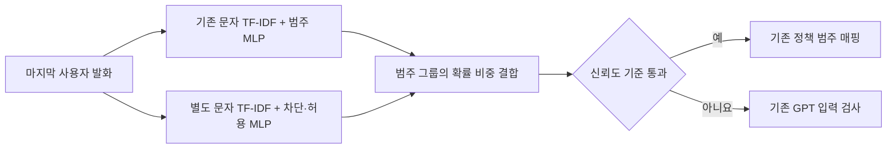

# R7 종료·추천 후보 — 2026-11-20

> **사용자 결정: A/B 비교 종료·B 우선 채택.** 각2회 평균 B 총점84.800/가드90.395, A84.140/88.085로 B가+.660/+2.310이며 평균 시간은 거의 같다. 우선 제출 후보는 `jh_r7_binary_guard`, 복귀 후보는 `jh_cm_char_mlp50`다. 통계적 우위는 미확정이나 현재 관측을 근거로 선택했다. 추가 B3/A3 반복은 진행하지 않는다. 코드 기본값·실행 중 서버는 변경하지 않았다. [결과·채택 이유](ROUND7_SUBMISSIONS.md). 아래는 이전 시점 이력이다.

> **새 A/B 비교 B1 수신:** 이진 가드85.96 / 튜터80.33 / 가드91.59 / 69.820초,600요청·공식 오류0. 공유된 총점·가드 최고 관측치를 갱신했다. 앞선 B2회와 별도 집계하며 새 비교 A는 아직 미수신이다. 단회·다른 seed로 우위는 미확정, 기존 A 보존·B 교대 비교 유지. [원결과·분석](ROUND7_SUBMISSIONS.md). 아래 기록은 각 시점의 이력이다.

> **R7 실제 제출 2회 수신:** `jh_r7_binary_guard` 총점84.07/84.97, 가드89.07/88.60. 평균 총점84.520·가드88.835·62.425초. 과거 A5회 평균 대비 총점−.120·가드+.389·Duration−7.864초지만 다른 seed·시점·표본 수라 개선은 미확정이다. A 보존, 이진 가드는 비교 후보 유지. 공식 오류0, 내부 오류 미확인. [원결과·분석](ROUND7_SUBMISSIONS.md). 아래 새 실제 제출 없음 표기는 제출 전 이력이다.

계정 사용량 표시가 **60% 사용/40% 잔여**에 도달한 시점에 새 실험을 중단했다. 그 전에 시작한 m06의 수집 응답 채점까지 완료했고 API 작업은 종료했다. `/tmp/jh_r7_stop_new`는 새 R7 묶음을 시작하지 않기 위한 로컬 표식이다. 이번 작업은 로컬 커밋까지이며 새로운 실제 제출 결과는 없다.

**새 제출 시험 우선 후보는 `jh_r7_binary_guard`다. 기존 최종 A `jh_cm_char_mlp50`와 C `jh_np_timeouts`는 보존한다.** 실제 제출에서 입증된 기존 A의 최고85.50과 아래 공개 개발 점수를 섞지 않는다. 기본 파이프라인을 자동 교체하지 않았다.

## 선택 근거

같은 가드196개를 사용하는 대조에서 새 이진 가드는 세 번 모두 A보다 높았다. 단독 가드와 혼합 부하는 서로 다른 조건이므로 각 회차의 A와 비교한다.

|대조|A 가드|이진 가드|차이|
|---|---:|---:|---:|
|g21 가드 단독|93.91|94.84|+0.93|
|g24 역순 가드 단독|94.76|96.63|+1.87|
|m06 튜터·가드 혼합|93.76|96.32|+2.56|

평균 짝차이 **+1.787점**. 공개 파생 자료를 반복 사용한 개발 결과이며 독립 홀드아웃이나 비공개 제출 성능의 추정치가 아니다. [회차별 집계](round7_guard_pair_summary.json).

매번 고친 두 입력은 교육 목적을 붙인 실제 제한 해제 요청과, 프롬프트 주입을 가상 예로 배우는 정상 학습 요청이었다. 원래 채점 기준에 따른 입력 교정/회귀는 g21 3/1, g24 4/1, m06 5/0이었다. 매번 반복된 채점상 회귀는 없었지만 정상 질문을 out_of_material로 분류한 의미상 오류는 남았다. 원래 평가기는 gold normal의 category를 별도 채점하지 않으므로 이를 숨기지 않고 구분했다. [입력 짝비교](round7_binary_input_pairs.json).

## 마지막 전체 서버 비교

같은 공개 파생388개(튜터192+가드196), HTTP·서버 동시성64, 제공 API/환경변수 유지, 순차 수집·순차 채점이다. 모두 형식 오류·채점 오류0이다. 내부 시간 초과는 별도로 존재한다.

|후보|총점|튜터|가드|수집 초|
|---|---:|---:|---:|---:|
|`jh_cm_char_mlp50`|94.73|95.70|93.76|39.750|
|`jh_r7_binary_guard`|95.42|94.53|96.32|42.086|
|`jh_r7_binary_tutor`|95.28|95.18|95.37|38.587|
|`jh_r7_binary_tutor12`|94.78|94.14|95.41|41.044|

이진 가드 단독은 A보다 총점+.69, 가드+2.56이고 수집은2.336초 길었다. 튜터 구현이 동일하므로 튜터−1.17은 이진 분류기의 기능 효과로 설명하지 않는다. m06 내부 실패 요청은 A29/이진48/결합8초73/결합12초70이었다. 내부 실패가 모두 HTTP 실패나 점수 손실을 뜻하지는 않지만 무시하지 않는다.

같은 judge payload의 첫/마지막 관측을 통일한 재생에서는 일부 총점 순위가 바뀌었다. 실제 수집·채점 결과를 대체하지 않으며 B와 결합8초의0.14점 차이를 안정적인 우열로 보지 않는다. 추천1순위는 그 차이보다 **가드의 세 번 반복 결과와 변경 범위**에 근거한다. [원래 결과](round7_results.json), [judge 변동 분석](round7_m06_judge_replay.json).

## 구조

아래는 새 **입력 분류 부분만** 그린 것이다. 검색·근거 투표·입력 결과에 따른 출력 안전성 경로는 A와 같다. 튜터의 기존 입력 분류와 답변 생성도 이진 가드 단독에서는 그대로다.



범주 MLP의 block/allow 그룹 내부 비율을 유지하고, 두 그룹의 총 확률만 이진 MLP의 판단으로 바꾼다. 공개400개로 처음부터 학습하며 외부 사전학습 분류기나 새 요청 저장은 없다. threshold .8776460484899311은 기존 grouped OOF의 비유해 상위50% 적용 범위에서 정한 값이다. 실제 요청의50%만 처리한다는 뜻이나 보정된 확률이라는 뜻은 아니다. harmful subtype·low-signal·LLM fallback은 기존 경로다. 분류를 위한 추가 GPT/임베딩 호출은 없다.

## 남긴 후보

1. **`jh_r7_binary_guard`**: 새 제출 우선. 가드만 바뀌고 세 번의 가드 대조가 상승했다.
2. **`jh_r7_binary_tutor`**: 숫자 질문 개선을 실제 제출에서 탐색할 결합8초 후보. 일반 혼합 총점95.28로 1순위보다.14 낮았다. 별도 숫자 개발32개에서 직접 설명은 A79.17→93.49였지만 결합 변형은90.36으로 흔들렸고 일부 계산·교재 범위 오류도 남았다. 숫자 진단 성적을 전체 제출 예상치로 환산하지 않는다.
3. **`jh_r7_binary_guard75`**: 호출 절감 비교용. g24 가드95.89, 채팅 시작465회(A632회)로26.4% 적었으나 기본 이진 가드96.63보다 낮았다. 점수 우선 기본 추천은 아니다.

12초 결합은 m06 총점94.78로 8초95.28보다 낮아 우선 추천에서 제외한다. 출처 고정 단계 비교에서는12초93.88/8초90.76이었지만 두 후보 모두 설명22회 완료·timeout1회였다. 시간 확대의 안정적 이득은 확인하지 못했다. [단계 비교](round7_tutor_component.json).

별도 숫자 설명 검토 호출, 광범위한 예시 추가, PCA/규제 변경, 공백 제거 분류기 등은 회귀하거나 반복 이득이 없어서 기본 후보에 넣지 않았다. 기존 실험 variant는 비교 재현을 위해 보존했다.

## 실행과 재현

브랜치: `experiment/kimjaehak-peace-guard-fusion`. 런박스에 새 코드를 반영한 뒤 기존 서버를 종료하고 실행한다. 이번 작업에서 원격 push는 하지 않았다.

```bash
.venv/bin/python experiments/jh_server.py \
  --variant jh_r7_binary_guard \
  --embedding-mode env \
  --request-slots 64 \
  --host 0.0.0.0 \
  --port 8000
```

비교 기준은 variant만 `jh_cm_char_mlp50`으로 바꾸고 나머지 조건은 동일하다. 주최측 OPENAI/EMBEDDING 환경변수와 API 키 처리도 기존 그대로다. 이번에 `.env`나 의존성을 변경하지 않았다. 모든 신규 GPT 호출은 비스트리밍·최대2000토큰이고, 숫자 설명의 추가 시간은 튜터26초 전체 deadline 안에서 제한한다. 가드28초 제한은 유지한다.

로컬 원본 개발 응답·판정 journal·동결한 수작업 진단은 `experiments/.cache`에 있고 Git/배포·훈련에 넣지 않는다. 집계·해시·분석·실행 코드는 저장소에 기록했다. 캐시가 없는 새 환경에서는 수작업 진단 결과를 그대로 재채점할 수 없으며, 제출 서버는 그 캐시를 필요로 하지 않는다.

## 검증·인수인계

- 전체 **965 unittest 통과**, `git diff --check` 통과.
- 보호 기준 `6ec111d` 대비 `core/`, `grader/`, `harness/score_local.py`, `server.py`, `SPEC.md`, `public/`, `kb/` 변경0.
- 코드 체크포인트 `6946d2e`. 이후 종료 정리는 결과/문서 변경이다.
- 완료한 HTTP 후보 실행 155회·반복 개발 응답 21,501개. 서로 다른 자료의 점수는 합산/평균내지 않는다. 이 수는 독립 문항 수가 아니며 CPU 교차검증·동결 응답 단계 재생은 제외했다. [완료 목록 집계](round7_completion_inventory.json).
- 기존 실제 제출 A/C 기록은 [A/C 반복 제출](AC_REPEAT_SUBMISSION.md), 모든 가설·실패·채택 근거는 [R7 상세 기록](ROUND7_IMPROVEMENTS.md)에 있다.

다음 검증은 실제 제출에서 A와 이진 가드를 번갈아 실행해 총점·가드·시간·내부 오류를 비교하는 것이다. 숫자 결합8초는 별도 후보로 비교한다. 미공개 요청/정답을 수집하지 않고 주최측이 반환한 집계 결과만 기록한다. 새 로컬 실험은 이번40% 중단 이후 자동으로 시작하지 않는다.
